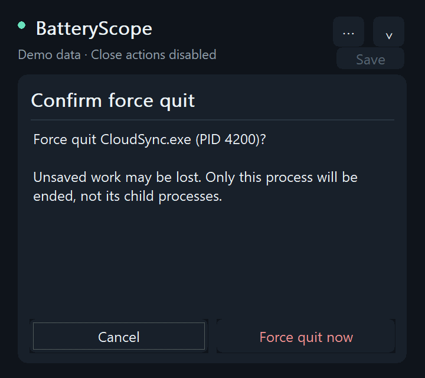

# BatteryScope 0.9.2

[繁體中文](README.md) | English

A small native Windows battery and background-process monitor built with C++17 and Win32. Portable, dark, bilingual, and entirely local. No web engine, telemetry, driver, or persistent service.


## Getting started

1. Download `BatteryScope-0.9.2-win64.zip` from [Releases](https://github.com/rio10255254/BatteryScope/releases/latest), extract it, and run `BatteryScope.exe` on Windows 11 x64.
2. Click its battery icon in the notification area to show or hide the panel. Esc hides it; monitoring continues at a lower frequency.
3. Open **⋯ → Language / 語言 → English** to switch immediately. The setting persists for your Windows account. Selection and scroll position are retained.
4. Use Background and Show filters, the mouse wheel, arrow keys, Home/End, or Page Up/Down. Enter or double-click opens details.
5. Select a process to inspect it, request a normal close, force quit with confirmation, or stop an eligible hosted service. Protected processes cannot be closed.

The menu also provides power mode, battery and charging details, session energy, finding power-hungry background apps, CSV export, appearance (theme and style), language, a low battery alert, the Ctrl+Alt+B shortcut, optional launch at sign-in, and Quit. Launch at sign-in is off until you enable it. If you move the folder, opening BatteryScope from the new location repoints the entry automatically; an entry for another BatteryScope copy that still exists is left unchanged. Windows permission dialogs, standard dialog buttons, and system-provided service names follow the system language.

**Appearance and extras**

- **Style:** **⋯ → Appearance** offers *Pixel style* (default) or *Smooth style*. Pixel style uses stair-stepped corners, pixel outlines, and buttons that sink into their shadow when pressed; the battery shows level cells, the 30-minute chart becomes pixel bars, process meters become segmented blocks, and large numbers use bitmap digits. Titles, labels, and buttons use an embedded pixel font. Process names, service names, and long detail text from Windows or apps keep the system font: any string with a character the pixel font lacks is drawn entirely in the system font, never as boxes.
- **Theme:** **⋯ → Appearance** offers *Use Windows setting* (default; follows the Windows app light/dark mode live), *Dark*, or *Light*. When a Windows contrast theme is on, the panel always uses system colors and outlines cards and buttons. Shapes, the chart, and the battery glyph are antialiased with GDI+; ranking rows show each app's icon, with a letter tile for protected processes whose path cannot be read.
- **Tray tooltip:** shows battery level, discharge watts, and estimated time left; while charging, charging watts and estimated time to full.
- **Session energy:** CPU energy (mWh) attributed to each app since BatteryScope started, grouping processes with the same name and keeping processes that have exited, with each app's share of total CPU core energy. Requires compatible CPU energy counters.
- **Low battery alert:** 10%, 20%, 30%, or off (default). On battery, one Windows notification appears when the level reaches the threshold, with current drain, time left, and the top consumer. It re-arms on external power or after recovering 5 points. Clicking it opens the panel.
- **Export CSV:** saves the current ranking (watts, range, session mWh, memory, path) and the 30-minute battery history (`-power.csv`) as UTF-8 CSV. Names that a spreadsheet would treat as formulas are prefixed with an apostrophe.
- **Shortcut:** when enabled (off by default), Ctrl+Alt+B shows or hides the panel from anywhere. If another app owns it, BatteryScope says so and leaves it off.

Style, theme, alert threshold, and shortcut settings are stored under `HKCU\Software\BatteryScope`; demo and screenshot modes never write them.

The power mode button at the top right shows **the Windows power mode in effect right now** (for example *Balanced*, *Efficiency*, or *Performance*; *Saver on* while Energy saver is active), read through the documented `PowerRegisterForEffectivePowerModeNotifications`. Click it, or use **⋯ → Power mode**, to open the power mode page. Windows keeps two separate settings, *Plugged in* and *On battery*; the page lists both with the current choice marked and switches either to *Efficiency*, *Balanced*, or *Performance*. Only the plugged-in setting applies while plugged in, so an on-battery *Efficiency* setting does not slow the computer down on AC power. The first time BatteryScope changes a setting it stores the original under the current user's BatteryScope registry key; **Restore original** brings it back. No apps or services are closed. Options the system does not provide are disabled.

**Energy saver settings** on the power mode page opens the Windows page where you can enable Energy saver or set its automatic threshold. The power mode page and battery details show the energy-saving status reported by Windows. BatteryScope does not use an undocumented switch to change this separate feature.

**⋯ → Find power-hungry background apps** is an inspection list, not an automatic action. It requires a valid CPU energy estimate and at least 75% observed CPU time, then considers only a verified, same-user, non-service background process with no visible window or visible/service-host ancestor, at least 60 seconds of sustained activity, and at least 0.5 W estimated CPU power. Up to five candidates are sorted by CPU watts. The app cannot infer the importance of sync, downloads, audio, unsaved work, or dependencies, and closing one is not guaranteed to save its displayed watts. It never suspends or closes candidates automatically.

## What the readings mean

- **Discharge W:** whole-machine battery drain reported by the battery. If unavailable, a sufficiently long absolute-capacity trend may provide a clearly identified estimate.
- **Charging W:** net power absorbed by the battery. This is not the charger's rating, wall power, or negotiated USB PD wattage.
- **Time to full:** an at-current-rate estimate after at least 60 seconds of continuous, stable charging. Missing readings, sleep, unplugging, capacity jumps, or a sharp rate change invalidate the estimate. Charging can taper near full; firmware charge limits are unknown.
- **Charge rate:** percentage points per hour, using recent charging watts and full-charge capacity. The chart switches between charging and discharge according to battery state.
- **Connector type:** unavailable. Generic Windows power status identifies external power but does not reliably distinguish barrel and USB-C charging. Finding a USB-C controller is not evidence of active charging through it.
- **Process watts:** estimated CPU-only energy allocation constrained by measured EMI core energy. The list sorts by a 30-second smoothed estimate. GPU, display, storage, and networking are not attributed to individual processes.
- **Coverage:** the observed CPU-time share, not an accuracy percentage. A shared service host is measured as one process; independent service wattages are not fabricated.
- **Monitoring scope:** every live process with a PID in the system snapshot is collected, including protected and other-user processes. Running Win32 services are mapped to their host PIDs. Drivers and kernel work may have no separate process and remain in System or unattributed energy. Processes that start and exit between samples cannot be listed individually. If the system snapshot fails, the Toolhelp fallback keeps processes it cannot open and marks their statistics unavailable.
- **No compatible energy counters:** the list falls back to CPU/I/O activity and leaves watt estimates unavailable.

The CPU model has been exercised on a Ryzen 9 8945HS with compatible EMI counters. Other hardware may fall back to activity ranking. See [algorithm details](ALGORITHM.md) and [validation records](VALIDATION.md).

## Interaction and resource use

The 360 × 640 logical-pixel panel adapts to DPI and smaller work areas. Process, battery, and candidate details, force-quit confirmation, and action errors stay inside the dark panel. Short confirmation pages shrink to 320 logical pixels and expand back to the ranking on return. Back or Esc returns to the selected row; Cancel has initial focus on the force-quit page. Service selection and Windows UAC still use system dialogs. Short finite animations ease opening, hiding, resizing, scrolling, row selection, hover, and button presses. Repeated same-direction scroll input carries velocity forward; reversing input changes direction without a position jump or overscroll.



List replacement is deferred during scrolling, presses, and in-panel information pages. Status hints explain which actions are available. Animations honor Windows' reduced-motion preference and stop their timer when idle or hidden. Sampling stays on a background thread: every 2 seconds while open, and 10–20 seconds while hidden with EcoQoS requested for the sampler. The app does not raise the system timer resolution.

Normal close allows the target to offer a save prompt. Force quit can lose unsaved work and affects only the selected process. Every action revalidates process identity and safety. Services with running dependents are not stopped; administrative permission is requested only when needed for an explicitly selected service operation.

## Build and test

```powershell
.\build.ps1 -Test
# Or MSVC with CMake:
cmake -S . -B build -A x64
cmake --build build --config Release
ctest --test-dir build -C Release --output-on-failure
```

To avoid replacing a running executable, use `-OutputDirectory dist/v0.9.2`. The version lives only in `src/version.h`; CMake checks that `app.manifest` matches. The tests read `src/` from the working directory to verify every UI string has an English translation. The CMake test suite includes an isolated panel integration test. Preview and test modes do not save preferences or terminate existing user processes.

```powershell
.\dist\BatteryScope.exe --demo
.\dist\BatteryScope.exe --demo-screenshot C:\temp\charging.bmp --english --charging
.\dist\BatteryScope.exe --ui-test C:\temp\panel-test.txt
.\dist\BatteryScope.exe --tray-test C:\temp\tray-test.txt
```

The destination folder must exist. Screenshots use synthetic data only when the demo option is selected. `--compact`, `--minimal`, `--plugged`, `--no-energy`, `--selected`, `--pixel`, `--smooth`, `--light`, `--dark`, `--high-contrast` (previews the contrast palette from current system colors), `--ledger`, and `--power-mode` are available for preview checks.

## Pixel font

`src/assets/pixel-ui.ttf` is a subset of [Cubic 11 (俐方體11號)](https://github.com/ACh-K/Cubic-11) 1.451 containing only the ~490 characters the UI strings use (about 110 KB), renamed "BatteryScope Pixel" and embedded in the EXE for private use; it is never installed system-wide. It is licensed under the SIL Open Font License 1.1; see `src/assets/pixel-ui-OFL.txt`.

After adding or changing UI strings, regenerate the subset (requires Python and `pip install fonttools`). The panel self-test checks that every Chinese and English UI string renders in the pixel font.

```powershell
python tools/subset-pixel-font.py path\to\Cubic_11.ttf
```

Power API references: [Battery status](https://learn.microsoft.com/en-us/windows/win32/power/battery-status-str), [system power status](https://learn.microsoft.com/en-us/windows/win32/power/system-power-status).
