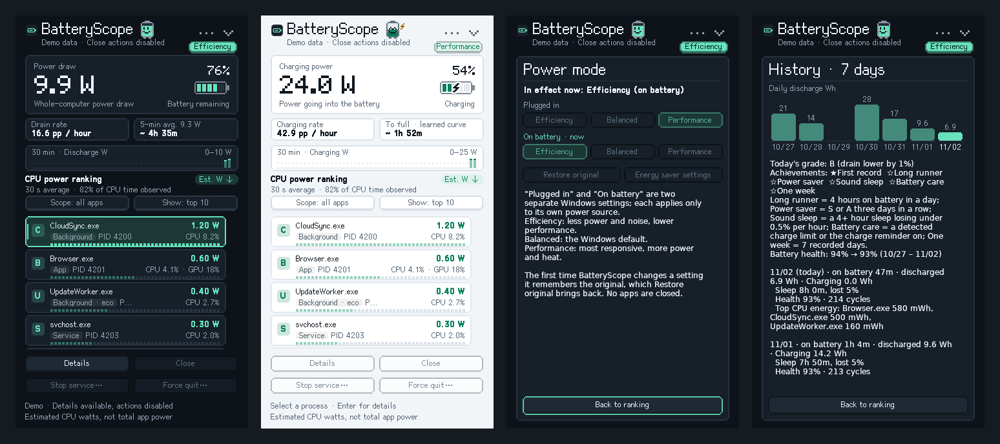
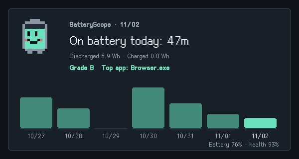

# BatteryScope

**A Windows laptop battery monitor that shows how much power each app is using.** One portable EXE, no installer, everything stays on your PC. Pixel-style interface (smooth style available), English and Traditional Chinese, dark and light themes.

[繁體中文](README.md) | English

[](https://github.com/rio10255254/BatteryScope/releases/latest)




<sub>Screenshots use the built-in demo mode's synthetic data.</sub>

## Download

From the **[Releases page](https://github.com/rio10255254/BatteryScope/releases/latest)**:

- **Installer (recommended):** `BatteryScope-0.16.0-setup.exe`. No administrator rights; installs to `%LOCALAPPDATA%\Programs\BatteryScope`, adds a Start menu shortcut, optionally a desktop shortcut and launch at sign-in, and uninstalls from Settings → Apps.
- **Portable:** `BatteryScope-0.16.0-win64.zip`; extract it and run `BatteryScope.exe`.

Requires Windows 10 version 1703 or later (Windows 11 recommended), 64-bit. The program is not code-signed; if SmartScreen appears the first time, choose **More info → Run anyway**. It lives in the notification area, where the icon shows the battery percentage; click it to show or hide the panel.

### Installing and updating

- **Older copies are closed first:** the installer closes any running BatteryScope (installed or portable, any version), cleanly first so it undoes its efficiency mode and power mode changes, and by force if it does not respond.
- **Shortcuts and pins follow the latest version:** every install goes to the same folder, so Start menu and desktop shortcuts, taskbar pins, and launch at sign-in keep working after updates. Installing also repoints shortcuts, taskbar pins, Windows 10 Start pins, and launch at sign-in that still open an older `BatteryScope.exe` elsewhere. The old portable folder is not deleted.
- **Update reminders:** once a day BatteryScope checks GitHub for a newer release and shows one notification per new version. Clicking it (or **⋯ → Install update**) downloads the installer, checks its SHA-256 against the published checksum, installs, and reopens BatteryScope; on a mismatch nothing runs and the download page opens instead. Turn off daily checks or check now under **⋯ → Updates**. A check only reads version information from `api.github.com` and sends no usage data.

## Supported PCs

| | Laptop | Desktop (no battery) |
| --- | --- | --- |
| Windows 11 | All features | The main card shows CPU power and a CPU W chart; the On battery power mode is disabled |
| Windows 10 (1703 or later) | All features; power mode changes only the setting for the current power source (1709 or later) | Same as above |

Per-app watt accuracy depends on the energy data the CPU provides (see below); PCs without it still rank apps by CPU/I/O activity. Windows 10 on ARM cannot run x64 apps; Windows 11 on ARM runs it under emulation but usually has no usable CPU energy channels.

## Highlights

- **Live power and time left:** whole-PC discharge or charge watts, drain rate, time left (shown as a range when the load is unsteady), time to full from a learned charging curve, and charge-limit detection.
- **Which app drains the battery:** estimated per-app watts from the CPU's hardware energy counters, plus CPU and GPU use; inspect, close, force quit, or stop a service.
- **Power modes in one click:** set *Plugged in* and *On battery* to Efficiency, Balanced, or Performance separately and see the mode Windows actually applies; per-app Efficiency mode and automatic switching rules.
- **Battery health:** health, cycle count, and their trend, plus sleep drain detection.
- **7-day history:** daily discharge chart, a daily grade and achievements, and a shareable summary card.
- **Helpful alerts:** low battery, background drain, sleep drain, and charge-level reminders.
- **Power lab (experimental):** records where battery power goes (CPU cores, the rest of the CPU, display/dGPU/rest) per activity, and runs alternating A/B experiments that measure how much CPU Boost, processor energy preference, screen refresh rate, and power mode actually save on this PC, and whether they cost smoothness.
- **Small and quiet:** tray resident, a mini floating window, the Ctrl+Alt+B shortcut, CSV export; no network access except the daily update check, no telemetry or background service.



Details follow.

## Using it

1. Download `BatteryScope-0.16.0-win64.zip` from [Releases](https://github.com/rio10255254/BatteryScope/releases/latest), extract it, and run `BatteryScope.exe` on a Windows 10 (1703 or later) or Windows 11 x64 laptop or desktop.
2. Click its battery icon in the notification area to show or hide the panel. Esc hides it; monitoring continues at a lower frequency.
3. Open **⋯ → Language / 語言 → English** to switch immediately. The setting persists for your Windows account. Selection and scroll position are retained.
4. Use Background and Show filters, the mouse wheel, arrow keys, Home/End, or Page Up/Down. Enter or double-click opens details.
5. Select a process to inspect it, request a normal close, force quit with confirmation, or stop an eligible hosted service. Protected processes cannot be closed.

The ⋯ menu keeps only the common items: power mode, dynamic power saving and its status page, battery and charging details, history, session energy, finding power-hungry background apps, the power lab, tools (CSV export, share card, mini window), settings, and Quit. Every other option is on the **⋯ → Settings** page, grouped into power saving, alerts, appearance, and general; each row shows its value and switches with one click. Launch at sign-in is off until you enable it. If you move the folder, opening BatteryScope from the new location repoints the entry automatically; an entry for another BatteryScope copy that still exists is left unchanged. Windows permission dialogs, standard dialog buttons, and system-provided service names follow the system language.

**Appearance and extras**

- **Style:** **⋯ → Appearance** offers *Pixel style* (default) or *Smooth style*. Pixel style uses stair-stepped corners, pixel outlines, and buttons that sink into their shadow when pressed; the battery shows level cells, the 30-minute chart becomes pixel bars, process meters become segmented blocks, and large numbers use bitmap digits. Titles, labels, and buttons use an embedded pixel font. Process names, service names, and long detail text from Windows or apps keep the system font: any string with a character the pixel font lacks is drawn entirely in the system font, never as boxes.
- **Theme:** **⋯ → Appearance** offers *Use Windows setting* (default; follows the Windows app light/dark mode live), *Dark*, or *Light*. When a Windows contrast theme is on, the panel always uses system colors and outlines cards and buttons. Shapes, the chart, and the battery glyph are antialiased with GDI+; ranking rows show each app's icon, with a letter tile for protected processes whose path cannot be read.
- **Tray tooltip:** shows battery level, discharge watts, and estimated time left; while charging, charging watts and estimated time to full.
- **Tray percentage:** the notification icon shows the battery percentage in pixel digits (on by default; turn off with **⋯ → Show battery % as tray icon**). The badge color shows the state: green when plugged in or charging, amber at 20% or below, red at 10% or below, dark gray otherwise, readable on dark and light taskbars.
- **Battery health:** battery and charging details show health (current full-charge capacity ÷ design capacity) and the charge cycle count; while plugged in and not charging, the left card on the main panel shows health too. Values the battery does not report read "Not reported"; cycle counts are not shown for multiple batteries.
- **Remaining-time range:** when the 5-minute and up-to-30-minute average drain differ by more than 15%, time left shows as a range (for example "~ 3.2–4.1 h"), so a short burst or lull does not make the number jump.
- **Charging curve and charge limit:** BatteryScope learns this computer's actual charging rate in each 5% band; when the learned bands cover the rest of the way, time to full follows that curve, including the slowdown near full. If the level holds steady between 40% and 96% for 3 minutes or more while plugged in, it is treated as a likely charge limit (battery care): the main panel shows "Charge limit 80%" and charging estimates the time to that limit. The curve and limit are stored under `HKCU\Software\BatteryScope`.
- **GPU use:** while the panel is open, rows show each app's GPU utilization when it is at least 1% (for example "CPU 4.1% · GPU 18%"), also in details and CSV. It comes from the Windows "GPU Engine" performance counters that Task Manager uses, taking the busiest engine type; it is utilization, not watts.
- **Background drain alert:** turn on with **⋯ → Background drain alert** (off by default). On battery, an app on the power-hungry background list that keeps averaging about 2 W or more for 10 minutes triggers one notification. Each app is reported once, notifications are at least 10 minutes apart, and clicking one opens the list.
- **History (7 days):** **⋯ → History (7 days)** shows daily discharge as a bar chart and lists each day's time on battery, energy discharged and charged, and top CPU-energy apps. Records stay on this computer in `%LOCALAPPDATA%\BatteryScope\history.csv` for 60 days, written every 10 minutes and on exit; time when BatteryScope is not running is not recorded. Stop or clear recording under **⋯ → History settings**. Demo and screenshot modes never read or write the file.
- **Sleep drain:** on battery, a gap of 10+ minutes between battery samples counts as a sleep (traditional sleep and Modern Standby, which pauses apps without a sleep notification). Battery details show the last sleep's length and drop; history keeps daily sleep time and drop. A notification (on by default; **⋯ → Sleep drain alert**) fires when a sleep lost 3+ points at more than 1.5 points per hour; clicking it opens battery details.
- **Minutes gained if closed:** process details and the background-app list show "If closed: about N more minutes" from the process's CPU watts at the 5-minute drain, excluding GPU and display and not guaranteed; hidden when plugged in or under a minute.
- **Charge reminder:** **⋯ → Charge reminder** at 80/85/90/100% (off by default) notifies once when plugged in at the target, re-arming on unplug or 5 points below; skipped when a detected charge limit is at or below the target.
- **Health trend:** daily history keeps battery health and cycle count; battery details and the history page show the change over the recorded days (for example 94% → 93%).
- **Per-app efficiency mode:** **Efficiency mode** on process details applies the same Efficiency mode as Windows 11 Task Manager (EcoQoS throttling plus idle priority) to the selected app, tagged "eco" in the list. Identity, same-user, critical-process, and service checks match closing an app. Press again to turn it off; everything BatteryScope set is undone when it exits.
- **Automatic power mode:** under **⋯ → Automatic power mode**, the low-battery saver (20% or 30%) sets On battery to Efficiency at the threshold, restored on external power or 10 points higher; the performance list (add apps from process details) sets both modes to Performance while a listed app runs, restored 30 seconds after they all exit. Automatic changes are undone only if you have not changed that mode since, on exit, and at the next start after a crash.
- **Battery buddy:** a pixel character beside the title whose body fills with the battery level and whose face follows the state (calm, sleepy, busy, charging, tired, critical, full), blinking now and then. Click it for a one-line status (time left, top app, time to full). Hide it under **⋯ → Appearance**.
- **Daily grade and achievements:** the history page grades today S–D by comparing the average drain on battery with the median of up to 14 earlier days, and lists six achievements (first record, long runner, power saver, sound sleep, battery care, one week), all computed from local history.
- **Share today's card:** **⋯ → Share today's card** saves a summary image (buddy, time on battery, energy, grade, top app, 7-day bars, level and health) as PNG and copies it to the clipboard.
- **Mini floating window:** **⋯ → Mini floating window** opens an always-on-top, non-activating, draggable window with the buddy, level, and watts; double-click opens the panel, right-click opens or hides it; its position is remembered.
- **Session energy:** CPU energy (mWh) attributed to each app since BatteryScope started, grouping processes with the same name and keeping processes that have exited, with each app's share of total CPU core energy. Requires compatible CPU energy counters.
- **Low battery alert:** 10%, 20%, 30%, or off (default). On battery, one Windows notification appears when the level reaches the threshold, with current drain, time left, and the top consumer. It re-arms on external power or after recovering 5 points. Clicking it opens the panel.
- **Export CSV:** saves the current ranking (watts, range, session mWh, memory, path) and the 30-minute battery history (`-power.csv`) as UTF-8 CSV. Names that a spreadsheet would treat as formulas are prefixed with an apostrophe.
- **Shortcut:** when enabled (off by default), Ctrl+Alt+B shows or hides the panel from anywhere. If another app owns it, BatteryScope says so and leaves it off.

Style, theme, alert threshold, and shortcut settings are stored under `HKCU\Software\BatteryScope`; demo and screenshot modes never write them.

The power mode button at the top right shows **the Windows power mode in effect right now** (for example *Balanced*, *Efficiency*, or *Performance*; *Saver on* while Energy saver is active), read through the documented `PowerRegisterForEffectivePowerModeNotifications`. Click it, or use **⋯ → Power mode**, to open the power mode page. Windows keeps two separate settings, *Plugged in* and *On battery*; the page lists both with the current choice marked and switches either to *Efficiency*, *Balanced*, or *Performance*. Only the plugged-in setting applies while plugged in, so an on-battery *Efficiency* setting does not slow the computer down on AC power. The first time BatteryScope changes a setting it stores the original under the current user's BatteryScope registry key; **Restore original** brings it back. No apps or services are closed. Options the system does not provide are disabled.

**Energy saver settings** on the power mode page opens the Windows page where you can enable Energy saver or set its automatic threshold. The power mode page and battery details show the energy-saving status reported by Windows. BatteryScope does not use an undocumented switch to change this separate feature.

**⋯ → Find power-hungry background apps** is an inspection list, not an automatic action. It requires a valid CPU energy estimate and at least 75% observed CPU time, then considers only a verified, same-user, non-service background process with no visible window or visible/service-host ancestor, at least 60 seconds of sustained activity, and at least 0.5 W estimated CPU power. Up to five candidates are sorted by CPU watts. The app cannot infer the importance of sync, downloads, audio, unsaved work, or dependencies, and closing one is not guaranteed to save its displayed watts. It never suspends or closes candidates automatically.

## Dynamic power saving (experimental, off by default)

Turn it on from **⋯ → Dynamic power saving** or the settings page. On battery it adjusts power mode, processor energy preference, and CPU Boost to what you are doing (refresh rate switching is a separate option because the screen blinks when it switches):

- **Activity:** idle, reading, in use, interactive, video or music, calls, heavy work, and full-screen games. The detector weighs many signals, gives each activity a confidence, keeps only those at 60% or more, and picks the most demanding of them:
  - **Keyboard and mouse (instant):** typing, clicking, or scrolling switches to "in use" at once, without waiting for the one-second check; moving the pointer alone does not.
  - **Foreground program (instant):** a program switch re-runs detection at once, and the program is categorised by name (browser, documents, development, chat, media, creative/compute, game).
  - **Screen:** whether the foreground window fills the screen (borderless full screen counts) and how many frames the compositor draws (whether anything is moving).
  - **GPU (every 2 s):** 3D, compute, and video decode engine use, so muted video is recognised and borderless games are found by "fills the screen + heavy 3D".
  - **Sound:** which program is playing; microphone or camera in use means a call.
  - **Other:** the CPU must be busy for 4 s to count as heavy (short spikes do not); a locked screen or display off is always idle.
  - Only timings, program names, and device states are read: no screenshots, no screen or text content, and no record of which keys were pressed.
- **App rules:** Settings → App rules sets "always save power", "always balanced", "performance first", or "leave alone" per program; programs in the performance list count as "performance first". When you (or G-Helper) move a setting the same way twice in the same program, the rule is learned and applied, and can be changed or forgotten in the same place.
- **Fast up, slow down:** moves toward performance are immediate (0.3 s between changes of a setting); moves toward saving wait until the activity has held for 6 s, longer when the detector is less sure (up to 12 s), and each setting has a minimum gap between changes.
- **Respects others:** a setting changed by G-Helper or you is left alone for 10 minutes.
- **Learns from the lab:** a saving is used only after an experiment on this PC proved it saves power without more late frames or slower responses; a proven cost vetoes it.
- **Battery target:** with a 3, 5, or 8 hour target, each activity uses the next more saving profile when the estimate falls short.
- **Background apps** busy for 30 s get efficiency mode (EcoQoS) until they come to the front.
- **Restore:** plugging in, a full-screen game, turning it off, or quitting restores your settings, as does the next start after a crash. It pauses while the lab measures.
- **Status page:** ⋯ → Dynamic power saving status shows the detected activity and confidence, its reasons, the other candidates, the foreground program and its rule, the target settings, and recent changes.
- **Detection accuracy:** during the automatic test, detection is scored against the activity actually running; the export summary shows the accuracy and `detection-log.csv` has every second.
- Diagnostics: `BatteryScope.exe --detect-test 30` prints what the detector sees for 30 seconds (without the GPU).

## Power lab (experimental)

**⋯ → Power lab** measures on your own PC instead of guessing which settings help. All data stays in `%LOCALAPPDATA%\BatteryScope\lab`.

- **Record detailed data:** every 2 seconds, also while the panel is hidden: battery watts, CPU package and core watts, their difference as "display, dGPU and the rest", system CPU use, time since the last input, whether sound is playing, whether the microphone or camera is in use, full-screen games, the foreground app, the refresh rate, whether the discrete GPU is awake and which apps use it, dropped frames reported by the Windows compositor, the power plan's CPU Boost and energy preference, and whether G-Helper runs (its config file is copied when it changes). One CSV per day, kept for 14 days.
- **Power by activity:** battery time is split into idle, interactive, video or music, calls, heavy work, and full-screen games, each with the average power and its parts, plus how often the discrete GPU was awake.
- **Quick test (about 25 minutes):** power mode in idle, browsing, typing, video, and sustained load (so detection accuracy covers every activity), plus dark mode and brightness, in 30-second blocks. `BatteryScope.exe --quicktest` also starts it.
- **Power goal** (⋯ → Power goal): goals for battery power in use and while still (10 W / 7 W by default), the last 30 minutes' averages and the gap, and the changes that would close it ranked by what the lab measured on this PC, plus busy background programs.
- **Full test (about 1.3 hours):** unplug and click once; it restores everything and exports to the desktop when done. Realistic, repeatable activities run in a separate full-screen Edge (or Chrome) profile: web browsing (article loads, smooth scrolling), 1080p VP9 video with sound, typing with spell check and autosave, a static page, plus sustained compute, so both settings of a pair face exactly the same work. It tests power mode, refresh rate, CPU Boost, energy preference, background-app efficiency mode, brightness (the test pages are light like most websites, so an OLED panel's brightness cost shows), and power mode under sustained load (the speed cost). Screen off is not measured: Modern Standby laptops go to standby soon after the screen turns off, so it would measure standby; 3 pairs of 45-second blocks each, measuring late frames, dropped video frames, page-load and keystroke response times, work rate, and energy per unit of work. A snapshot of power plans, the battery report, hardware and drivers, brightness, processes, startup apps, running tasks, and services is saved at the end. Esc or closing the browser stops it. Without a browser it uses built-in loads. `BatteryScope.exe --autotest` also starts it.
- **A/B experiments:** one setting at a time: CPU Boost on/off, processor energy preference, top refresh rate/60 Hz, power mode balanced/efficiency. On battery the setting alternates every 2 minutes in pairs of blocks in random order; the first 20 seconds of each block are skipped, and a block in which another program (such as G-Helper) changed the setting is discarded and repeated. After 8 pairs it stops and restores the setting; results compare the pairs for battery, CPU cores, display/dGPU/rest, CPU use, and dropped frames, with 95% ranges.
- **Safety:** settings change only on battery, pause and restore when plugged in, and are restored after a stop, quit, or crash at the next start. The refresh rate change is temporary and not saved, so a restart also undoes it. CPU Boost and energy preference live in the active power plan; if Windows requires administrator rights the lab says so and never elevates itself.
- **One-click export:** **Export (zip + copy summary)** zips the whole lab folder (daily CSVs, experiment blocks, G-Helper config copies and a summary) to the desktop and copies the summary text to the clipboard, ready to paste into a message. It uses the `tar.exe` built into Windows 10 1803 and later, and opens the folder instead when that is unavailable.
- **Limits:** sampling every 2 seconds uses a little power itself, equally for both settings. Doing different things during the two settings adds noise, so results carry a range and say when there is no clear difference. Dropped frames come from the compositor; some full-screen or variable-refresh content may not be counted.

## What the readings mean

- **Discharge W:** whole-machine battery drain reported by the battery. If unavailable, a sufficiently long absolute-capacity trend may provide a clearly identified estimate.
- **Charging W:** net power absorbed by the battery. This is not the charger's rating, wall power, or negotiated USB PD wattage.
- **Time to full:** an at-current-rate estimate after at least 60 seconds of continuous, stable charging. Missing readings, sleep, unplugging, capacity jumps, or a sharp rate change invalidate the estimate. Charging can taper near full; firmware charge limits are unknown.
- **Charge rate:** percentage points per hour, using recent charging watts and full-charge capacity. The chart switches between charging and discharge according to battery state.
- **Connector type:** unavailable. Generic Windows power status identifies external power but does not reliably distinguish barrel and USB-C charging. Finding a USB-C controller is not evidence of active charging through it.
- **Process watts:** estimated CPU-only energy allocation constrained by measured EMI core energy. The list sorts by a 30-second smoothed estimate. GPU, display, storage, and networking are not attributed to individual processes.
- **Coverage:** the observed CPU-time share, not an accuracy percentage. A shared service host is measured as one process; independent service wattages are not fabricated.
- **Monitoring scope:** every live process with a PID in the system snapshot is collected, including protected and other-user processes. Running Win32 services are mapped to their host PIDs. Drivers and kernel work may have no separate process and remain in System or unattributed energy. Processes that start and exit between samples cannot be listed individually. If the system snapshot fails, the Toolhelp fallback keeps processes it cannot open and marks their statistics unavailable.
- **No compatible energy counters:** the list falls back to CPU/I/O activity and leaves watt estimates unavailable.

The energy source is chosen automatically from the EMI channels the PC provides, and the details page shows which one is in use: **per-core** (AMD Ryzen, most precise), **all-core total** (most Intel PCs, multi-package systems, and PCs with more than 64 logical processors; the range is 0.8–1.25 times the estimate), or **package** (package energy only; the idle floor is subtracted first). Without any of them no watts are invented and the list ranks by CPU/I/O activity. Per-core mode has been verified on a Ryzen 9 8945HS; the other modes are unit-tested but not yet verified on Intel or desktop hardware. See [algorithm details](ALGORITHM.md) and [validation records](VALIDATION.md).

## Interaction and resource use

The 360 × 640 logical-pixel panel adapts to DPI and smaller work areas. Process, battery, and candidate details, force-quit confirmation, and action errors stay inside the dark panel. Short confirmation pages shrink to 320 logical pixels and expand back to the ranking on return. Back or Esc returns to the selected row; Cancel has initial focus on the force-quit page. Service selection and Windows UAC still use system dialogs. Short finite animations ease opening, hiding, resizing, scrolling, row selection, hover, and button presses. Repeated same-direction scroll input carries velocity forward; reversing input changes direction without a position jump or overscroll.


List replacement is deferred during scrolling, presses, and in-panel information pages. Status hints explain which actions are available. Animations honor Windows' reduced-motion preference and stop their timer when idle or hidden. Battery device handles are kept open and re-enumerated only after a read failure, every 5 minutes, or every minute while no battery is found; while hidden, the service list refreshes every 30 seconds (actions still re-check it live). Sampling stays on a background thread: every 2 seconds while open, and 10–20 seconds while hidden with EcoQoS requested for the sampler. The app does not raise the system timer resolution.

Normal close allows the target to offer a save prompt. Force quit can lose unsaved work and affects only the selected process. Every action revalidates process identity and safety. Services with running dependents are not stopped; administrative permission is requested only when needed for an explicitly selected service operation.

## Build and test

```powershell
.\build.ps1 -Test
# Or MSVC with CMake:
cmake -S . -B build -A x64
cmake --build build --config Release
ctest --test-dir build -C Release --output-on-failure
```

To avoid replacing a running executable, use `-OutputDirectory dist/v0.16.0`. The version lives only in `src/version.h`; CMake checks that `app.manifest` matches. The tests read `src/` from the working directory to verify every UI string has an English translation. The CMake test suite includes an isolated panel integration test. Preview and test modes do not save preferences or terminate existing user processes.

```powershell
.\dist\BatteryScope.exe --demo
.\dist\BatteryScope.exe --demo-screenshot C:\temp\charging.bmp --english --charging
.\dist\BatteryScope.exe --ui-test C:\temp\panel-test.txt
.\dist\BatteryScope.exe --tray-test C:\temp\tray-test.txt
```

The destination folder must exist. Screenshots use synthetic data only when the demo option is selected. `--compact`, `--minimal`, `--plugged`, `--no-energy`, `--selected`, `--pixel`, `--smooth`, `--light`, `--dark`, `--high-contrast` (previews the contrast palette from current system colors), `--ledger`, `--power-mode`, `--history`, and `--desktop` (a PC without a battery) are available for preview checks; in demo mode `--card-png <path>` writes the share card.

## Pixel font

`src/assets/pixel-ui.ttf` is a subset of [Cubic 11 (俐方體11號)](https://github.com/ACh-K/Cubic-11) 1.451 containing only the ~490 characters the UI strings use (about 110 KB), renamed "BatteryScope Pixel" and embedded in the EXE for private use; it is never installed system-wide. It is licensed under the SIL Open Font License 1.1; see `src/assets/pixel-ui-OFL.txt`.

After adding or changing UI strings, regenerate the subset (requires Python and `pip install fonttools`). The panel self-test checks that every Chinese and English UI string renders in the pixel font.

```powershell
python tools/subset-pixel-font.py path\to\Cubic_11.ttf
```

Power API references: [Battery status](https://learn.microsoft.com/en-us/windows/win32/power/battery-status-str), [system power status](https://learn.microsoft.com/en-us/windows/win32/power/system-power-status).
