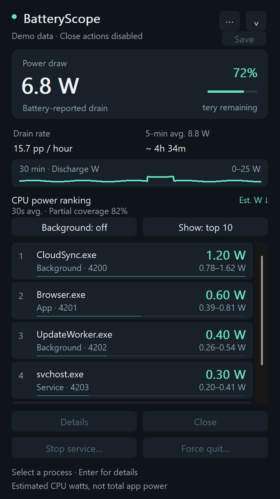

# BatteryScope 0.9.0

[繁體中文](README.md) | English

A small native Windows battery and background-process monitor built with C++17 and Win32. Portable, dark, bilingual, and entirely local. No web engine, telemetry, driver, or persistent service.



## Getting started

1. Download `BatteryScope-0.9.0-win64.zip` from [Releases](https://github.com/rio10255254/BatteryScope/releases/latest), extract it, and run `BatteryScope.exe` on Windows 11 x64.
2. Click its battery icon in the notification area to show or hide the panel. Esc hides it; monitoring continues at a lower frequency.
3. Open **⋯ → Language / 語言 → English** to switch immediately. The setting persists for your Windows account. Selection and scroll position are retained.
4. Use Background and Show filters, the mouse wheel, arrow keys, Home/End, or Page Up/Down. Enter or double-click opens details.
5. Select a process to inspect it, request a normal close, force quit with confirmation, or stop an eligible hosted service. Protected processes cannot be closed.

The menu also provides battery and charging details, optional launch at sign-in, and Quit. Launch at sign-in is off until you enable it. Windows permission dialogs, standard dialog buttons, and system-provided service names follow the system language.

The **Save** button sets Windows' battery-side power mode to **Best power efficiency** with one click; **Undo** restores the previous mode, even after restarting BatteryScope. The previous setting is stored under the current user's BatteryScope registry key. While plugged in, this configures the mode for the next battery session. This changes the Windows power mode, not the separate Energy saver switch, and does not close apps or services. The button is unavailable if the Windows API is unsupported or Best efficiency was already selected outside BatteryScope.

## What the readings mean

- **Discharge W:** whole-machine battery drain reported by the battery. If unavailable, a sufficiently long absolute-capacity trend may provide a clearly identified estimate.
- **Charging W:** net power absorbed by the battery. This is not the charger's rating, wall power, or negotiated USB PD wattage.
- **Time to full:** an at-current-rate estimate after at least 60 seconds of continuous, stable charging. Missing readings, sleep, unplugging, capacity jumps, or a sharp rate change invalidate the estimate. Charging can taper near full; firmware charge limits are unknown.
- **Charge rate:** percentage points per hour, using recent charging watts and full-charge capacity. The chart switches between charging and discharge according to battery state.
- **Connector type:** unavailable. Generic Windows power status identifies external power but does not reliably distinguish barrel and USB-C charging. Finding a USB-C controller is not evidence of active charging through it.
- **Process watts:** estimated CPU-only energy allocation constrained by measured EMI core energy. The list sorts by a 30-second smoothed estimate. GPU, display, storage, and networking are not attributed to individual processes.
- **Coverage:** the observed CPU-time share, not an accuracy percentage. A shared service host is measured as one process; independent service wattages are not fabricated.
- **Monitoring scope:** every live process with a PID in the system snapshot is collected, including protected and other-user processes. Running Win32 services are mapped to their host PIDs. Drivers and kernel work may have no separate process and remain in System or unattributed energy. Processes that start and exit between samples cannot be listed individually. If the system snapshot fails, the Toolhelp fallback keeps processes it cannot open and marks their statistics unavailable.
- **No compatible energy counters:** the list falls back to CPU/I/O activity and leaves watt estimates unavailable.

The CPU model has been exercised on a Ryzen 9 8945HS with compatible EMI counters. Other hardware may fall back to activity ranking. See [algorithm details](ALGORITHM.md) and [validation records](VALIDATION.md).

## Interaction and resource use

The 360 × 640 logical-pixel panel adapts to DPI and smaller work areas. Short finite animations ease opening, hiding, scrolling, row selection, hover, and button presses. Repeated same-direction scroll input carries velocity forward; reversing input changes direction without a position jump or overscroll.

List replacement is deferred during scrolling, presses, and modal dialogs. Status hints explain which actions are available. Animations honor Windows' reduced-motion preference and stop their timer when idle or hidden. Sampling stays on a background thread: every 2 seconds while open, and 10–20 seconds while hidden with EcoQoS requested for the sampler. The app does not raise the system timer resolution.

Normal close allows the target to offer a save prompt. Force quit can lose unsaved work and affects only the selected process. Every action revalidates process identity and safety. Services with running dependents are not stopped; administrative permission is requested only when needed for an explicitly selected service operation.

## Build and test

```powershell
.\build.ps1 -Test
# Or MSVC with CMake:
cmake -S . -B build -A x64
cmake --build build --config Release
ctest --test-dir build -C Release --output-on-failure
```

To avoid replacing a running executable, use `-OutputDirectory dist/v0.9.0`. The CMake test suite includes an isolated panel integration test. Preview and test modes do not save preferences or terminate existing user processes.

```powershell
.\dist\BatteryScope.exe --demo
.\dist\BatteryScope.exe --demo-screenshot C:\temp\charging.bmp --english --charging
.\dist\BatteryScope.exe --ui-test C:\temp\panel-test.txt
.\dist\BatteryScope.exe --tray-test C:\temp\tray-test.txt
```

The destination folder must exist. Screenshots use synthetic data only when the demo option is selected. `--compact`, `--minimal`, `--plugged`, `--no-energy`, and `--selected` are available for preview checks.

Power API references: [Battery status](https://learn.microsoft.com/en-us/windows/win32/power/battery-status-str), [system power status](https://learn.microsoft.com/en-us/windows/win32/power/system-power-status).
