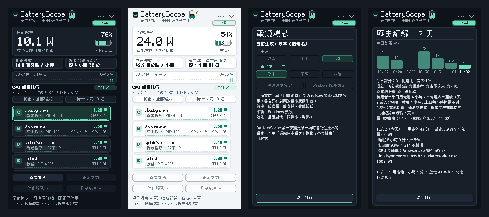
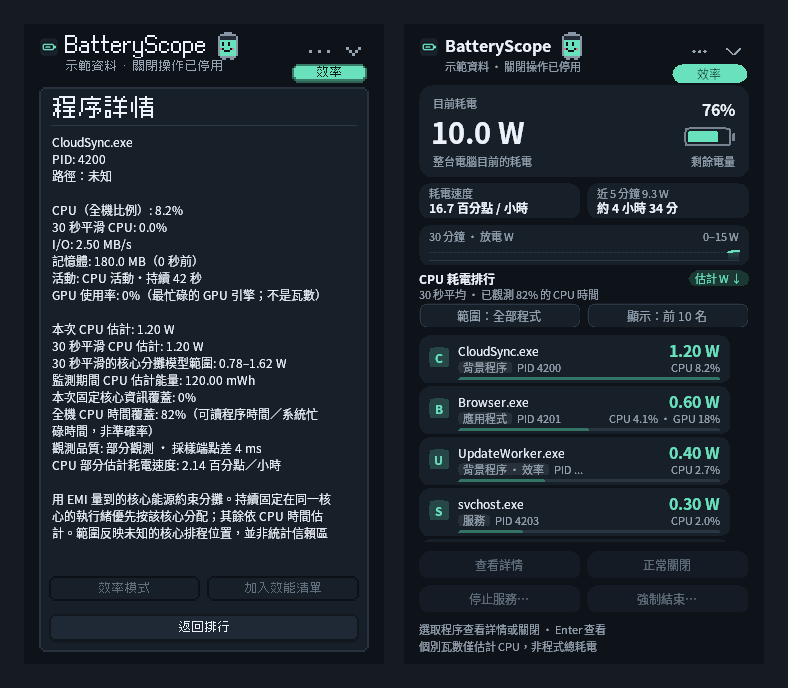
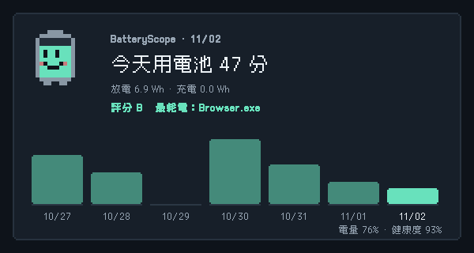

# BatteryScope

**看得見每個程式吃掉多少電的 Windows 筆電耗電監測工具。** 單一 EXE、免安裝、資料只留在本機，介面為像素風格（也可切換平滑風格），支援繁體中文／英文與深色／淺色主題。

[English](README.en.md) | 繁體中文

[](https://github.com/rio10255254/BatteryScope/releases/latest)




<sub>截圖為程式內建示範模式的模擬資料。</sub>

## 下載

到 **[Releases 頁面](https://github.com/rio10255254/BatteryScope/releases/latest)** 下載：

- **安裝版（建議）**：`BatteryScope-0.26.0-setup.exe`。不需要管理員權限，安裝到 `%LOCALAPPDATA%\Programs\BatteryScope`，會建立開始功能表捷徑，可選擇桌面捷徑與登入時啟動，並可從「設定 → 應用程式」解除安裝。
- **免安裝版**：`BatteryScope-0.26.0-win64.zip`，解壓後執行 `BatteryScope.exe`。

需要 Windows 10 1703 以上（建議 Windows 11），64 位元。程式沒有數位簽章，第一次開啟若出現 SmartScreen，點「其他資訊 → 仍要執行」。開啟後在右下角系統匣，圖示會顯示電量百分比；點圖示開關面板。

### 安裝與更新

- **自動結束舊版**：安裝前會先關閉正在執行的 BatteryScope（安裝版或免安裝版、任何版本）。先讓它正常結束，以還原它設定的效率模式與電源模式；沒有回應才強制結束。
- **捷徑與釘選自動指向新版**：每次都安裝到同一個資料夾，所以開始功能表、桌面、工作列釘選與登入時啟動在更新後仍然有效。安裝時也會把仍指向舊位置 `BatteryScope.exe` 的捷徑、工作列釘選、Windows 10 開始釘選與登入啟動，全部改指向安裝版。舊的免安裝資料夾不會被刪除，可自行刪除。
- **更新（0.17 起集中在「設定 → 更新」）**：每天檢查一次 GitHub 上的最新版本。預設「自動安裝新版本」：下載安裝程式、比對 SHA-256 校驗碼後安裝並重新開啟（自動測試進行中會等測試與匯出結束）；也可改成「有新版本時通知我」或「不要自動檢查」，同一個選單裡可立即檢查或安裝。有新版時「⋯」選單最上面會出現「安裝更新」。校驗不符時不會執行，改開啟下載頁。檢查時只會向 `api.github.com` 讀取版本資訊，不會傳送任何使用資料。

## 支援的電腦

| | 筆電 | 桌機（沒有電池） |
| --- | --- | --- |
| Windows 11 | 全部功能 | 主畫面改顯示 CPU 功率與 CPU W 曲線；「用電池時」電源模式停用 |
| Windows 10（1703 以上） | 全部功能；電源模式只能變更目前供電來源那一項（1709 以上） | 同上 |

每個程式的瓦數準確度取決於 CPU 提供的能源資料（見下方「硬體相容性」）；沒有能源資料的電腦仍可依 CPU／I/O 活動排行。不支援 Windows on ARM 的 Windows 10（無法執行 x64 程式）；Windows 11 on ARM 可透過模擬執行，但通常沒有可用的 CPU 能源通道。

## 能做什麼

- **即時耗電與續航**：整機放電／充電瓦數、耗電速度、剩餘時間（負載不穩時顯示區間）、依學到的充電曲線預估充滿時間，並偵測充電上限。
- **哪個程式最耗電**：依硬體 CPU 能源計數器分攤每個程式的估計瓦數並排行，另顯示 CPU 與 GPU 使用率；可查看詳情、正常關閉、強制結束或停止服務。
- **電源模式一鍵切換**：分別設定「插電時」與「用電池時」的效率／平衡／效能，顯示 Windows 實際生效的模式；可對單一程式開啟效率模式，或設定自動切換規則。
- **電池健康**：健康度、充電循環次數與長期趨勢，睡眠期間掉電偵測。
- **7 天歷史紀錄**：每日放電量長條圖、每日評分與成就，可輸出分享卡片。
- **貼心提醒**：低電量、背景程式偷耗電、睡眠耗電、充到指定電量時發出通知。
- **省電實驗室（實驗功能）**：記錄用電池時耗電花在哪裡（CPU 核心、CPU 其他部分、螢幕／獨顯／其他），依你正在做的事分開統計，並用輪流切換的 A/B 實驗，量出 CPU Boost、處理器能源偏好、螢幕更新率、電源模式在這台電腦上實際省多少電、會不會掉格。
- **穩定性與問題回報**：藍屏、意外關機、凍結、顯示驅動重置自動記錄停止代碼與當時狀態（黑盒子），一鍵把回報包存到桌面、摘要複製到剪貼簿。
- **小巧不打擾**：系統匣常駐、迷你浮動視窗、Ctrl+Alt+B 快速鍵、匯出 CSV；除了每天檢查一次新版本外沒有網路連線，沒有遙測或常駐服務。





以下為詳細說明。

## 使用方式

1. 從 [GitHub Releases](https://github.com/rio10255254/BatteryScope/releases/latest) 下載 `BatteryScope-0.26.0-win64.zip`，解壓後執行 `BatteryScope.exe`。已編譯版本適用 Windows 10（1703 以上）與 Windows 11 的 x64 筆電與桌機。
   升級時先從系統匣結束舊版，再執行新版；程式會避免同時啟動多個正式監測視窗。
2. 目前耗電顯示電池回報的整機放電功率；資料累積後顯示平均功率、耗電速度與預估續航。
3. 硬體能源資料可用時，下方依「估計 CPU W」由高到低列出前 10 個程序／服務。每張卡片第二行顯示類型、PID 與核心分攤模型範圍。點「僅背景」切換背景篩選，點「顯示」切換前 10 名／全部；滑鼠滾輪或鍵盤上下鍵瀏覽。若能源資料不可用，會明確退回 CPU / I/O 活動排行。
4. 選取程序後，可查看詳情、正常關閉、強制結束，或選擇其所屬服務並停止。
5. 點工作列通知區／系統匣的電池小圖示，面板會在圖示附近彈出；再次點擊即收回。也可按 Esc 或右上角收回按鈕。面板不另外佔用工作列應用程式按鈕；收回後繼續低頻採樣。Windows 若把圖示放在隱藏區，可從工作列的向上箭頭找到。
6. 右上角「⋯」或圖示右鍵選單只放常用項目：「電源模式」、「動態省電」與其狀態頁、「電池與充電詳情」、「歷史紀錄」、「本次累計耗能」、「找出耗電的背景程式」、「省電實驗室」、「工具」（匯出 CSV、分享卡片、迷你視窗）、「設定」與「結束 BatteryScope」。其餘所有選項都在「⋯ → 設定」頁，依「省電」「提醒」「外觀」「一般」分組，每一列直接顯示目前的值，點一下即可切換。登入啟動預設不會主動設定；勾選後寫入目前使用者的 Run 登錄項，登入時啟動至系統匣。若移動了資料夾，下次從新位置手動開啟時會自動把登入啟動改指向新位置；登錄項若指向另一個仍存在的 BatteryScope，則不會變更，需在選單重新勾選。

面板右上角的電源模式按鈕顯示 **Windows 目前實際生效的電源模式**（例如「平衡」「效率」「效能」，節能工具開啟時為「節能中」），資料來自 Windows 公開的 `PowerRegisterForEffectivePowerModeNotifications`。點擊或從「⋯ → 電源模式」開啟電源模式頁：Windows 的「插電時」與「用電池時」是兩個獨立設定，頁面同時列出兩者並標示目前的選擇，各可直接切換為「效率／平衡／效能」。插電時只有「插電時」的設定生效，所以「用電池時」設為效率並不會在插電時降低效能。BatteryScope 第一次變更某一項時，會把原本的設定記在目前使用者的 BatteryScope 登錄項，「還原原本設定」可恢復；不會結束任何程式或服務。系統不提供某項設定時，該排選項會停用。

電源模式頁的「Windows 節能設定」可直接開啟 Windows 自己的節能設定頁，由使用者決定是否啟用「節能工具」及自動啟用門檻；電源模式頁與電池詳情都會顯示 Windows 回報的節能狀態。BatteryScope 不使用未公開介面代替使用者切換節能工具。

「⋯ → 找出耗電的背景程式」只提供**人工檢查清單**：須有可靠的 CPU 能源資料、至少 75% 的 CPU 時間覆蓋，且該程序屬目前使用者、非服務、沒有可見視窗、未連到可見應用程式或服務宿主，並持續活動至少 60 秒、估計 CPU 功率至少 0.5 W。依估計 CPU W 排列最多 5 個。這不能看出同步／下載是否重要、音訊是否正在播放、檔案是否未儲存，亦不代表關閉後必定省下顯示的瓦數；不會自動休眠、停止或終止候選。

面板預設寬 360、高 640 個邏輯像素，比 0.3 版面積減少約 33%，隨 Windows DPI 縮放，並限制在螢幕工作區內。較矮的螢幕會隱藏趨勢圖以保留排行操作空間。程序詳情、充電資訊、節能候選、強制結束確認及操作失敗提示都在同一深色面板內顯示；短確認頁縮至 320 邏輯像素高，返回排行後恢復原高度。服務選擇及必要的 Windows UAC 仍使用系統對話框。


展開時約 220 ms 淡入並短距離滑出，收回約 150 ms；快速再次點擊會從當前進度反向，不排隊播放。按鈕提供約 120 ms 的懸停過渡及按壓回饋，程序耗電條以約 260 ms 過渡到新比例。卡片懸停與選取底色平滑過渡，按壓回彈約 130 ms。瓦數與範圍直接顯示最新估計值，動畫只影響視覺呈現。動畫結束就停止計時器，收回後仍採低頻監測；遵循 Windows 的動畫效果偏好。不提高全系統計時器解析度，實際流暢度依 Windows 排程與顯示環境而異。

清單滾輪採約 180 ms 的逐像素平滑捲動，接受不足一格的滾輪增量並遵循 Windows 捲動行數設定。連續同向輸入累加目的地並保留受限的前進速度，以 Hermite 曲線銜接；反向時直接從目前位置轉向，避免越界回彈；拖曳捲軸則立即跟手。上下鍵、Home／End、Page Up／Down 可選取與移動，Enter 查看詳情。資訊頁的「返回排行」與 Esc 可回到原選取項；確認頁預設焦點在「取消」。捲動、拖曳、按住控制項或面板內資訊頁期間暫緩清單刷新，結束後套用最新排行，盡可能保留頂端程序與列內偏移；切換篩選會回到頂端。收回面板會取消尚未完成的捲動。

### 動態省電（實驗功能，預設關閉）

在「⋯ → 動態省電」或設定頁開啟。用電池時依你正在做的事調整「電源模式」、「處理器能源偏好」與「CPU Boost」（螢幕更新率需另外開啟，因為切換時畫面會閃一下）：

- **判斷活動**：閒置、閱讀、操作中、一般操作、看影片／聽音樂、視訊／通話、高負載、全螢幕遊戲。偵測器會同時看多個訊號，每種活動各給一個把握程度，只採用把握夠高（60% 以上）的判斷，並選其中最需要效能的一個：
  - **鍵盤與滑鼠（即時）**：打字、點擊、捲動後立刻切到「操作中」，不等每秒的檢查；只移動游標不會觸發。
  - **前景程式（即時）**：切換程式時立刻重新判斷，並依程式名稱分類（瀏覽器、文書、程式開發、通訊、影音、創作／運算、遊戲）。
  - **畫面**：前景視窗是否蓋滿整個螢幕（無邊框全螢幕也算）、畫面合成器每秒畫了幾格（判斷畫面是否在動）。
  - **顯示卡（每 2 秒）**：3D、運算與影片解碼引擎的使用率，所以靜音播放影片也認得出來，無邊框全螢幕遊戲靠「蓋滿螢幕＋大量 3D」辨識。
  - **聲音**：哪個程式正在發出聲音；麥克風／相機使用中代表通話。
  - **其他**：CPU 持續忙碌 4 秒以上才算高負載（短暫尖峰不算）；鎖定螢幕或螢幕關閉一律視為閒置。
  - 只讀取時間、程式名稱和裝置使用狀態，不截圖、不讀畫面或文字內容，也不記錄按了哪些鍵。
- **程式規則**：在「設定 → 程式規則」可為個別程式指定「一律省電」「固定平衡」「效能優先」「不要管理」。效能清單裡的程式自動視為「效能優先」。你（或 G-Helper）在同一個程式裡兩次把設定往同一個方向改，就會學起來自動套用，可在同一處修改或忘記。
- **預設檔（依第一次實測調整，0.17 起）**：除了「開啟／載入中」（輸入或切換程式同時 CPU 突然變忙，例如開程式、載入網頁）、高負載與通話以外，一律用效率模式並關閉 CPU Boost——實測效率模式只慢幾毫秒，Boost 輕度使用多耗約 5 W。開啟／載入中與高負載用平衡。電量低於「低電量」設定（預設 20%）加強一級省電、低於一半加強兩級；耗電超過省電目標也加強一級，且背景程式效率模式提早到 15 秒。
- **快升慢降**：要提高效能時立刻切換（每項設定只隔 0.3 秒）；要省電時需該活動持續 6 秒，偵測把握越低等得越久（最多 12 秒），每項設定之間也有最短間隔，避免來回跳動。
- **尊重其他程式**：G-Helper 或你自己改了某項設定，那一項暫停管理 10 分鐘。
- **向實驗室學習**：只有在這台電腦的實驗中證實「省電、且延遲畫格或反應時間沒有變差」的設定才會採用；證實有代價的設定則不碰。
- **續航目標**：設定 3／5／8 小時後，若預估續航不足，每種活動會改用更省電一級的設定。
- **背景程式**：在背景持續忙碌 30 秒的程式自動進入效率模式（EcoQoS），回到前景立即解除。
- **還原**：插電、全螢幕遊戲、關閉功能或結束程式時還原原本設定；當機後下次啟動也會還原。實驗室進行測試時，動態省電暫停。
- 「⋯ → 動態省電狀態」顯示目前判斷的活動與把握程度、判斷依據、其他可能、前景程式與它的規則、目標設定、暫停中的項目、學到的結果與最近的調整。
- **偵測準確率**：一鍵自動測試期間會同時記錄偵測結果，對照實際執行的情境算出準確率，寫在匯出摘要裡，逐秒紀錄在 `detection-log.csv`（含前景程式的顯示卡使用與最忙的程式），這台電腦回報的顯示卡引擎種類列在 `gpu-engines.txt`。
- 診斷：`BatteryScope.exe --detect-test 30` 會連續 30 秒印出偵測器看到的訊號與判斷（不含顯示卡）。

### 介面（0.25 起）

面板底部有分頁：**效能**（首頁）、**省電**、**電池**、**硬體**（華碩筆電）、**實驗**、**設定**。每個分頁上面是即時圖表，下面是可以直接點的操作列，點一下就切換或就地跳出選項；方向鍵選擇、Enter 執行、Esc 回電池分頁。每個設定只在一個地方調整；長說明收在可以點開的摺疊列裡。分頁從它所在的那一側滑入，數值變更時會短暫發亮，游標指到圖表會顯示該點的數值（Windows 關閉動畫時全部停用）：

- **效能**（首頁）：一行電量摘要（電量、耗電、剩餘時間），效能模式（華碩：自動／靜音／平衡／Turbo；其他電腦：Windows 電源模式），CPU 的溫度、時脈、負載、功耗與近 5 分鐘曲線，內顯使用率與獨顯狀態（獨顯醒著時才讀溫度、時脈、功耗，不會為了顯示叫醒它），風扇轉速與**風扇模式**（原廠／安靜／標準／強力，取自韌體各模式自己的曲線），**CPU 功耗上限**（原廠／省電 15 W／輕量 25 W／標準 45 W，不超過平衡模式），以及 CPU Boost 開關。**模式連動（插電時）**：切換效能模式時，像 G-Helper 一樣一併設定該模式的 CPU Boost 與 Windows 電源模式（預設：靜音 Boost 關、平衡維持你原本的設定、Turbo 積極；有 G-Helper 設定檔時沿用它的各模式設定），可在同一列調整或關閉。風扇與功耗在每次切換效能模式後自動重新套用，選「原廠」即還原。
- **省電**：最近 30 分鐘對照目標、即時耗電曲線，所有省電開關都在這裡並分成三組——自動省電（動態省電、背景程式效率模式、動態切換螢幕更新率、低電量自動省電）、螢幕與裝置（用電池時 60 Hz、深色模式、獨顯自動 Eco、鍵盤背光與 Slash）、目標與規則（省電目標、程式規則、Windows 電源模式），接著是依實測排序的省電建議與動態省電的判斷。
- **電池**：電量、健康度、30 分鐘耗電圖與程式耗電排行；點電池下方的卡片可看近 7 天、充電上限（華碩）、哪些程式用掉電、值得檢查的背景程式、匯出與分享。
- **硬體**：見下一節。
- **實驗**：開始測試（快速／完整／單項）、結果圖表、資料（匯出、記錄、資料夾）。
- **設定**：提醒、外觀與一般選項；省電相關的開關都在「省電」分頁。
- 「⋯」只留快速切換與工具：動態省電、交回手動設定、電源模式、華碩效能模式、工具（CSV、分享卡片、迷你視窗）、穩定性與問題回報、記錄剛剛發生的問題、結束。動態省電開著時，標題旁的模式標籤會顯示「動態 · 目前判斷」，點一下就到省電分頁。

**誰在管哪個設定**：實驗量測中由實驗獨占；你在 BatteryScope 手動選的電源模式或華碩效能模式，這次用電池期間優先（可一鍵交回）；其餘由動態省電依程式規則與活動決定；動態省電關閉時才由「低電量時自動省電」與效能清單的自動切換接手。你手動設成效率模式的程式不會被動態省電改動。

### 穩定性與問題回報（0.23 起）

電腦藍屏、突然重開、凍結或畫面閃黑時，BatteryScope 會記下發生了什麼、當時在做什麼，一鍵就能把資料交給開發者：

- **黑盒子**：每 10 秒把電量、耗電、CPU 溫度與功耗、效能模式、風扇與功耗預設、獨顯狀態、更新率、動態省電的判斷、實驗步驟與前景程式寫進 `%LOCALAPPDATA%\BatteryScope\stability\blackbox.bin`。檔案固定 360 KB、保留最近 2 小時，每筆直接寫到磁碟（write-through），藍屏或強制關機也不會遺失。BatteryScope 每次寫入硬體設定（華碩 ACPI、電源設定、更新率、亮度）**之前**都會先記一筆，所以當機前 BatteryScope 是否剛改過什麼一目了然。
- **開機後讀取 Windows 記錄**：藍屏（Kernel-Power 41、BugCheck 1001，附停止代碼與參數）、沒有藍屏的意外關機（6008）、長按電源鍵強制關機、電池耗盡、顯示驅動重置（Display 4101、LiveKernelEvent 141／117）、硬體錯誤（WHEA）、磁碟錯誤（disk、stornvme、Ntfs、volmgr）。同一次當機的多筆記錄合成一件（兩次當機再接近也分開算），顯示實際當機的時間（6008 記下的時間，而不是下次開機的時間），標出 Windows 沒能寫下傾印檔的情況（volmgr 161，表示當機當下系統磁碟已無法寫入），並對上黑盒子裡當機前最後的狀態。同一個程式反覆當掉只保留最新 20 筆，不會把系統記錄擠掉。之後每 15 分鐘再讀一次新記錄。
- **凍結偵測**：一個高優先權的執行緒每秒醒來一次；螢幕開著時如果整台電腦有 2.5 秒以上沒讓它執行（以不含睡眠時間的計時器計算，避開睡眠與螢幕關閉前後 30 秒），就記為一次凍結。面板本身 30 秒沒回應會存一份 BatteryScope 自己的傾印檔；BatteryScope 當掉時也會留下 `crash-*.txt` 與傾印檔。
- **已知會造成藍屏的驅動**：裝了 National Instruments（LabVIEW／PXI）的 PCI 橋接驅動（nipcibrd、nipbcfk）時，穩定性頁會提醒並說明怎麼安全移除。
- **通知**：發現新的藍屏、意外關機或凍結時跳出通知，點一下打開「穩定性」頁；首頁「效能」也會在 7 天內有問題時顯示一行提醒。
- **穩定性頁**（首頁的提醒列或「⋯ → 穩定性與問題回報」）：最近 30 天的次數、每一件的停止代碼名稱與可能的方向（儲存裝置、顯示卡、睡眠喚醒…）、當時狀態，以及：
  - **建立回報包**：桌面產生 `BatteryScope-report-日期.zip`，摘要同時複製到剪貼簿可直接貼上。內含摘要（附最近 7 天安裝的驅動與更新、傾印檔的停止代碼與相關驅動）、黑盒子、事件記錄全文、BatteryScope 自己的傾印檔、驅動程式與磁碟資訊（含 SSD 韌體）、Windows 可靠性記錄、近 3 天系統錯誤、已安裝更新、電源設定與電池報告。
  - **含藍屏傾印檔的回報**：另外經管理員權限複製 `C:\Windows\Minidump` 最近 5 個與 LiveKernelReports 最近 2 個（64 MB 以下）傾印檔。
  - **記錄剛剛發生的問題**：卡頓、閃退或任何異常後按一下，把那個時間點與之前的狀態標記起來（也在「⋯」選單裡）。
- 只讀取本機記錄，不會自動上傳任何東西；回報包要不要給人、給誰由你決定。

**防護（0.23.2 起）**：BatteryScope 不能修好硬體或驅動的問題，但會確保自己不在危險的時刻動手：

- **電源切換時不寫入**：進入睡眠、螢幕關閉（Modern Standby 的開始）、登出／關機／重新啟動的過程中，所有硬體與電源設定寫入一律擋下（連底層的華碩 ACPI 與電源設定寫入都會拒絕）；闔蓋後 20 秒、喚醒後 10 秒、螢幕亮起後 5 秒、程式啟動後 8 秒（開機自動啟動時 25 秒）內，自動調整全部暫停。你自己按的按鍵與選項不受喚醒後等待的影響。
- **保護模式**：偵測到 24 小時內的當機，會自動進入保護模式——只監測，動態省電、自動更新率、獨顯自動、低電量自動切換、鍵盤背光自動關閉、實驗、開機與喚醒後重新套用華碩設定全部暫停，直到你按「恢復自動調整」。也可以隨時自己開啟（穩定性頁或「⋯」選單），適合排查問題的觀察期。
- **啟動順序**：先讀 Windows 的當機記錄（決定要不要進保護模式），再還原上次當機遺留的設定，最後才套用記住的華碩設定；啟動當下不寫入任何東西。
- **G-Helper 並存**：G-Helper 正在執行、或它的設定有 CPU 降壓／顯示卡超頻時，「下一步」會提醒（兩個程式控制同一個韌體介面會互相覆蓋）。
- **穩定性頁**改成一眼看懂：最上面一句現況（一切正常／觀察中／7 天內幾次／保護模式）、30 天時間軸（每天一格，紅色是當機）、「下一步」清單（能自動確認的會打勾：睡眠喚醒 3 次、正常重開 1 次、連續 3 天沒當機）、每一次問題的白話說明與當時狀態。首頁有問題或保護模式時會顯示同樣的橫幅。

**控制檢查（0.24 起）**：穩定性頁的「檢查每項控制是否真的有作用」會在你的電腦上逐項實測（約 40 秒），不是只看寫入有沒有報錯：

- 螢幕更新率、Windows 電源模式、CPU Boost、處理器能源偏好、螢幕亮度：寫入另一個值、讀回、還原。用電池時 CPU Boost 另外量負載下的時脈差異。
- 華碩效能模式（韌體不回報目前模式）：靜音與 Turbo 各跑幾秒全核心負載，比較 CPU 功耗，差 15% 以上才算有作用。
- CPU 功耗上限：設成 15 W 後同樣的負載，功耗要明顯下降。
- 風扇曲線、鍵盤背光：韌體或鍵盤只接受寫入、沒有可讀回的值，標示為「只能寫入」，不會說成有作用。
- 獨顯 Eco：每次切換本來就會讀回確認，這裡不實際切換（會關掉正在用獨顯的程式）。充電上限：只能從充電行為判斷（插電時電量停在上限附近）。
- 結果會留在頁面上、複製到剪貼簿、寫進回報包；被判定「沒有作用」的設定，自動測試會略過。
- 診斷：先結束 BatteryScope，再執行 `BatteryScope.exe --verify-controls | more`，每項一行。

### 華碩硬體（0.18 起，華碩筆電）

「華碩」分頁直接透過華碩的 ATKACPI 驅動（ASUS System Control Interface，Armoury Crate 與 G-Helper 也用它）與鍵盤、燈效的 HID 介面讀寫設定，不需要 G-Helper 或 Armoury Crate：

- **狀態**：型號、效能模式、獨顯 Eco／標準、畫面輸出（混合或獨顯直連）、充電上限、Overdrive、CPU／獨顯溫度、風扇轉速、功耗上限（讀值為 0 的項目不顯示）。
- **效能模式與充電上限**：多數機型（包括 G14 2024）的韌體只接受寫入、不會回報目前值。BatteryScope 和 G-Helper 一樣記住最後設定的值，開機與睡眠喚醒後自動重新套用；沒設定過時顯示「未設定」。
- **切換**：效能模式（靜音／平衡／Turbo）、獨顯 Eco（有程式在用獨顯時會先警告，寫入後讀回確認）、充電上限 60／80／100%、螢幕 Overdrive。
- **動態省電**：開啟時也管理效能模式——輕度使用用靜音，開啟／載入中、通話與高負載用平衡，遊戲與「不要管理」的程式還原。兩次切換至少隔 20 秒，避免風扇忽快忽慢。
- **實驗**：快速測試與完整測試會量靜音模式能省多少（非華碩電腦自動略過），證實有效才採用。
- **用電池時 60 Hz**（0.21 起，預設開啟）：拔掉電源切到 60 Hz、插上回到最高更新率；之後手動改的不會被覆蓋。「省電」分頁上方有每一項省電的開關。
- **獨顯自動**：用電池時 Eco、插電時標準（等同 G-Helper 的 Optimized），有程式在用獨顯時會等它關閉再切。
- **鍵盤背光**：關／低／中／高，經由鍵盤的 HID 介面設定（ROG 機型），並可在用電池時閒置 30 秒自動關閉、一碰就恢復。
- **Fn 鎖定**：Fn+C 或 Fn+Esc 切換。韌體有 Fn 鎖定的機型直接用韌體；ROG 機型由 BatteryScope 把 F1–F11 對應成快捷功能（靜音、背光、燈效、效能模式、截圖、亮度、投影、觸控板、睡眠）。
- **Slash 燈效**（Zephyrus G14／G16 2024）：開關、16 種燈效、亮度、動畫停頓、用電池時關閉；Fn+F4 開關。
- **華碩按鍵**：華碩的軟體不在時，BatteryScope 自動接手所有 Fn 鍵——螢幕亮度、鍵盤背光、觸控板、麥克風靜音、睡眠、飛航模式、表情符號、Fn 鎖定、效能模式（Fn+F5）與 ROG 鍵（開啟 BatteryScope、切換效能模式或不動作），並在畫面下方顯示結果。按鍵同時從 ATK WMI 事件與鍵盤 HID 輸入讀取（和 G-Helper 一樣）；華碩的軟體還在執行時，交給它處理，不會重複動作。
- **華碩服務**：一鍵停止並停用 Armoury Crate 與華碩背景服務（與 G-Helper 停止的清單相同，觸控板與系統控制驅動不動；需要管理員權限，原本的啟動方式會記下），之後可恢復停止前的設定，或「恢復成華碩預設（自動啟動）」——被 G-Helper 停用過的服務也能用這個救回來。
- 診斷：`BatteryScope.exe --asus-dump` 列出讀到的每個韌體值、記住的設定，以及每個華碩 HID 介面的報告編號。
- 風扇模式與 CPU 功耗上限在「效能」首頁調整（0.22 起）。

### 省電實驗室（實驗功能）

「⋯ → 省電實驗室」用來在你自己的電腦上量測，而不是猜測哪些設定有用。所有資料只存在 `%LOCALAPPDATA%\BatteryScope\lab`。

- **記錄詳細資料**：開啟後每 2 秒記錄一次（收起面板時也一樣）：電池瓦數、CPU 封裝與核心瓦數、兩者相減得到的「螢幕／獨顯／其他」、全機 CPU 使用率、多久沒操作、是否在播放聲音、麥克風或相機是否使用中、是否全螢幕遊戲、前景程式、螢幕更新率、獨顯是否醒著及哪些程式在用、Windows 畫面合成器的掉格數、目前電源計畫的 CPU Boost 與能源偏好，以及 G-Helper 是否在執行（它的設定檔變更時會另存一份）。每天一個 CSV，保留 14 天。
- **依活動拆解耗電**：把用電池的時間分成閒置、一般操作、看影片／聽音樂、視訊／通話、高負載、全螢幕遊戲，各自顯示平均耗電由哪幾塊組成，以及獨顯醒著的時間比例。
- **快速測試（約 25 分鐘）**：電源模式在閒置、瀏覽、打字、看影片與持續運算各測一次（偵測準確率也涵蓋所有情境），再加上深色模式與亮度；每段 30 秒。`BatteryScope.exe --quicktest` 也可開始。
- **省電目標**（「⋯ → 省電目標」）：設定使用時與靜態時的耗電目標（預設 10 W／7 W），顯示最近 30 分鐘的平均與差距，並依這台電腦的實測省電量排出該做的調整與正在耗電的背景程式。
- **完整測試（約 1.3 小時）**：拔掉電源後點一下，結束後自動還原並匯出到桌面。它用獨立設定檔的 Edge（或 Chrome）全螢幕執行可重現的真實情境：瀏覽網頁（載入文章、平滑捲動）、看影片（1080p VP9 含聲音）、打字文書（拼字檢查、自動儲存）、靜止閱讀，再加上持續運算；兩種設定面對完全相同的工作，結果才準。測試項目：電源模式、螢幕更新率、CPU Boost、處理器能源偏好、背景程式效率模式、螢幕亮度（測試頁是白底，跟大多數網站一樣，OLED 螢幕的亮度成本才量得出來），以及高負載下的電源模式（運算速度代價）。不測「螢幕關閉」：Modern Standby 筆電關螢幕後很快進入待機，量到的是待機而不是螢幕。每項 3 組、每段 45 秒（前 10 秒不計），同時量延遲畫格、影片掉格、頁面載入與打字反應時間、運算速度與每單位工作耗電。結束後另存電源計畫、電池報告、硬體與驅動、亮度、程序、開機程式、執行中工作與服務的快照。按 Esc 或關閉瀏覽器即可中止。沒有瀏覽器時改用內建的捲動、短暫運算與持續運算。也可用 `BatteryScope.exe --autotest` 開始。
- **A/B 實驗**：一次測一個設定：CPU Boost 開／關、處理器能源偏好、螢幕最高更新率／60 Hz、電源模式平衡／效率。用電池時每 2 分鐘輪流切換，每兩段為一組、組內順序隨機；每段前 20 秒不計，被其他程式（例如 G-Helper）改動過的段落會排除並重做。完成 8 組後自動停止並還原，結果以成對比較顯示電池、CPU 核心、螢幕／獨顯／其他、CPU 使用率與掉格的差異和 95% 範圍。
- **安全**：只在用電池時切換；插電時暫停並還原；停止、結束或當機後下次啟動都會還原原本的設定。螢幕更新率使用不寫入登錄的暫時切換，重新開機也會恢復。CPU Boost 與能源偏好寫在目前的電源計畫，若 Windows 要求系統管理員權限，實驗室會說明，不會自行提升權限。
- **一鍵匯出**：「一鍵匯出（壓縮檔＋複製摘要）」把整個實驗室資料夾（每日 CSV、實驗區段、G-Helper 設定備份與摘要）壓縮到桌面，並把摘要文字複製到剪貼簿，可直接貼到訊息裡。壓縮使用 Windows 10 1803 起內建的 `tar.exe`；不可用時改為開啟資料夾。
- **限制**：記錄本身每 2 秒取樣也會用一點電（兩種設定相同，不影響比較）。實驗期間你做的事不同會增加誤差，所以結果附有範圍，差異不明確時會直接說明。掉格數來自畫面合成器，部分全螢幕或可變更新率畫面可能不計入。

### 語言與操作提示

「⋯ → 語言 / Language」可即時切換 **繁體中文 / English**，保留選取身分與捲動位置。設定寫入目前使用者的 `HKCU\Software\BatteryScope\Language`，下次啟動沿用；示範及截圖模式不寫入設定。Windows 的 UAC、原生對話框標準按鈕與系統服務名稱沿用系統語言。

按鈕懸停顯示簡短說明；底部依選取目標提示無視窗、受保護、服務宿主或建議正常關閉。選單與收回按鈕有可供輔助閱讀的文字名稱。沒有可停止服務時停用停止按鈕；選擇服務時預設選取可停止項目。

### 外觀、累計耗能與提醒

- **風格**：「⋯ → 外觀」可選「像素風格」（預設）或「平滑風格」。像素風格的卡片與按鈕使用階梯角、像素外框與按壓下沉的陰影，電池改為格狀電量，30 分鐘圖改為像素長條，耗電條改為分段方塊，大數字以點陣數字繪製；標題、標籤與按鈕使用內嵌的點陣字型。程序名稱、服務名稱、詳情頁長文等由系統或程式提供的文字仍用系統字型；任何字串只要有點陣字型沒有的字，就整串改用系統字型，不會出現方框。
- **主題**：「⋯ → 外觀」可選「跟隨 Windows」（預設，依 Windows 應用程式深色／淺色設定即時切換）、「深色」或「淺色」。Windows 高對比主題啟用時一律改用系統色彩，卡片與按鈕加上外框。圓角、圖表與電池圖示使用 GDI+ 平滑繪製；排行列顯示各程式的圖示，無法讀取路徑的受保護程序以字首方塊代替。
- **系統匣提示**：滑鼠停在圖示上會顯示電量、放電瓦數與預估續航；充電時改為充電瓦數與預估充滿時間。
- **系統匣電量數字**：系統匣圖示直接以點陣數字顯示電量百分比（預設開啟，可在「⋯ → 系統匣顯示電量數字」關閉）。底色表示狀態：插電／充電為綠色、20% 以下為橘色、10% 以下為紅色，其餘為深灰，在深色與淺色工作列上都清楚可讀。
- **電池健康度**：「電池與充電詳情」顯示健康度（目前滿充容量 ÷ 原廠設計容量）與充電循環次數；插電但未充電時，首頁左側小卡片也改顯示健康度。電池未回報設計容量或循環次數時顯示「未提供」；多顆電池時不顯示循環次數。
- **剩餘時間區間**：近 5 分鐘與最長 30 分鐘的平均耗電差距超過 15% 時，續航改以區間顯示（例如「約 3.2–4.1 小時」），短暫的高負載或閒置不會讓數字大幅跳動。
- **充電曲線與充電上限**：BatteryScope 會記住這台電腦在每個 5% 電量區間的實際充電速度；學到的區間涵蓋剩餘路程時，「至充滿」會依充電曲線預估接近滿電時的減速。插電但電量長時間（3 分鐘以上）停在 40–96% 不動時，判定可能有充電上限（電池保護），首頁顯示「充電上限 80%」，充電時改預估到上限的時間。曲線與上限存在 `HKCU\Software\BatteryScope`。
- **GPU 使用率**：面板開啟時，排行列顯示每個程式的 GPU 使用率（≥1% 才顯示，例如「CPU 4.1% · GPU 18%」），詳情頁與 CSV 也有。資料來自工作管理員使用的 Windows「GPU Engine」效能計數器，取最忙碌的 GPU 引擎；這是使用率，不是瓦數。
- **背景耗電提醒**：可在「⋯ → 背景耗電提醒」開啟（預設關閉）。用電池時，若「找出耗電的背景程式」名單中的程式持續 10 分鐘以上、平均約 2 W 以上，會發出一次通知；每個程式只提醒一次，通知間隔至少 10 分鐘，點通知可直接查看名單。
- **歷史紀錄（7 天）**：「⋯ → 歷史紀錄（7 天）」以長條圖顯示每日放電量，並列出每日用電池時間、放電／充電量與 CPU 最耗電的程式。紀錄只存在這台電腦的 `%LOCALAPPDATA%\BatteryScope\history.csv`，保留 60 天，每 10 分鐘與結束時寫入；BatteryScope 沒有執行的時間不會被記錄。可在「⋯ → 歷史紀錄設定」停止記錄或清除；示範與截圖模式不讀寫此檔。
- **睡眠耗電偵測**：用電池時，兩次電池採樣之間相隔 10 分鐘以上即視為睡眠（傳統睡眠與 Modern Standby 都適用，後者不會送出睡眠通知、只會暫停程式）。「電池與充電詳情」顯示上次睡眠的時間與掉電，歷史紀錄保存每日睡眠時間與掉電。掉電 3% 以上且每小時超過 1.5% 時發出通知（預設開啟，「⋯ → 睡眠耗電提醒」可關閉），點通知開啟電池詳情。
- **關閉可多用多久**：程序詳情與耗電背景程式清單會顯示「若關閉此程式，CPU 部分約可多用 N 分鐘」，以近 5 分鐘耗電估算，不含 GPU、螢幕，也不是保證值；插電時或少於 1 分鐘時不顯示。
- **充電提醒**：「⋯ → 充電提醒」可選 80/85/90/100%（預設關閉）。插電且電量達到設定值時通知一次，拔電或低於設定值 5% 後才會再提醒；已偵測到等於或低於設定值的充電上限時不提醒。
- **電池健康度趨勢**：歷史紀錄每天保存健康度與循環次數，電池詳情與歷史紀錄頁顯示紀錄期間的變化（例如 94% → 93%）。
- **單一程式效率模式**：程序詳情頁的「效率模式」會對選取的程式套用與 Windows 11 工作管理員相同的效率模式（EcoQoS 降速執行＋最低優先順序），排行列以「效率」標示；與關閉程式相同，會先確認程序身分、同使用者、非系統關鍵程序且非服務。再按一次即取消；結束 BatteryScope 時會自動還原所有由它設定的程式。
- **自動電源模式**：「⋯ → 自動電源模式」可設定低電量省電（20% 或 30%，用電池且電量降到門檻時把「用電池時」切到效率，接上電源或回升 10% 後還原），以及「效能清單」（在程序詳情頁按「加入效能清單」；清單中的程式執行時，插電與用電池都切到效能，全部結束 30 秒後還原）。自動切換只還原自己做的變更：若你在期間手動改過，就保留你的設定；BatteryScope 結束或意外中止後下次啟動時也會還原。
- **電池小精靈**：標題旁的像素小角色，身體會隨電量填滿，表情依狀態變化（平靜、想睡、忙碌、充電、疲累、快沒電、充滿），每隔幾次採樣眨眼；點牠會說出目前狀況（續航、最耗電的程式、充滿時間）。可在「⋯ → 外觀」關閉。
- **每日評分與成就**：歷史紀錄頁依今天用電池時的平均耗電與過去最多 14 天的中位數比較，給出 S～D 評分；另有 6 個成就（初次紀錄、長跑者、省電達人、好眠、電池保養、一週紀錄），全部由本機歷史紀錄計算。
- **分享今日卡片**：「⋯ → 分享今日卡片」把今天的摘要（小精靈、用電池時間、放電／充電、評分、最耗電程式、7 天長條圖、電量與健康度）存成 PNG，並同時複製到剪貼簿。
- **迷你浮動視窗**：「⋯ → 迷你浮動視窗」開啟一個永遠在最上層、不搶焦點、可拖曳的小視窗，顯示小精靈、電量與瓦數；雙擊開啟面板，右鍵可開啟面板或隱藏；位置會記住。
- **本次累計耗能**：自 BatteryScope 啟動以來，依 CPU 能源分攤累計各程式的耗能（mWh），同名程式的多個程序合併計算，已結束的程序也保留，並顯示占 CPU 核心總耗能的比例。需有可用的 CPU 能源計數器。
- **低電量提醒**：可選 10%、20%、30% 或關閉（預設關閉）。電池供電且電量降到門檻時，發出一次 Windows 通知，內容包含目前耗電、預估續航與耗電最高的程序；接上電源或回升 5 個百分點後才會再次提醒。點通知可開啟面板。
- **匯出 CSV**：將目前程序排行（含瓦數、範圍、累計 mWh、記憶體、路徑）與 30 分鐘電量紀錄（`-power.csv`）存成 UTF-8 CSV。程序名稱開頭若像試算表公式，會加上單引號避免被執行。
- **快速鍵**：啟用後可在任何地方按 Ctrl+Alt+B 開關面板（預設關閉）；若已被其他程式使用，會提示且不啟用。

風格、主題、提醒門檻與快速鍵設定都寫入 `HKCU\Software\BatteryScope`；示範及截圖模式不寫入。

### 充電資訊

- 充電時主卡片顯示 **電池端充電 W**，同一區域顯示充電速度（百分點／小時）、至充滿的估計時間及充電 W 曲線。
- 功率取自電池回報的淨充入速率，不是插座耗電、充電器額定功率，也不是 USB PD 協商功率。相對容量或未回報充電速率的電池可能沒有 W。
- 平均取最近最多 2 分鐘的連續有效資料。需至少 60 秒、正向充電且功率相對穩定才顯示至充滿時間；拔電、停止充電、睡眠、缺值與容量異常跳動會重新累積。突然降速時暫停 ETA。
- 時間按剩餘 Wh / 較低的即時與平均充電 W 計算；接近滿電時會減速，韌體的充電保護上限也未知，因此只表示「依目前速度」，不是保證時間。滿電或接電但沒有充電時不編造倒數。
- 「⋯ → 電池與充電詳情」提供容量、平均充電 W 與限制說明。通用 Windows 電源資訊只能確認外部電源，**此版無法可靠區分圓孔或 USB-C**，接頭類型顯示未提供。USB-C 控制器的存在不能證明目前由它供電。

不需要安裝額外的 C++ 執行階段或網頁引擎。除了可關閉的每日更新檢查（只讀取 GitHub 上的版本資訊）外沒有網路請求；沒有遙測、常駐系統服務、驅動程式或資料庫。

## 量測與限制

- **整機 W**：使用 `IOCTL_BATTERY_QUERY_STATUS` 讀取電池回報值。硬體實際更新速率與準確度依機型而異。
- **缺少瓦數**：累積至少 2 分鐘、最多近 5 分鐘的絕對容量變化後，嘗試估算平均放電 W，介面會標示估算。只有相對容量／百分比時不換算瓦數。
- **平均與續航**：以近 5 分鐘有效樣本的時間加權平均估算。未滿 5 分鐘時使用已有資料；平均至少累積 10 秒，依功率推估續航至少累積 30 秒。續航是當前負載維持不變的估計。
- **耗電速度**：有絕對容量時以平均 W / 滿充 Wh 換算百分點／小時；否則以至少 2 分鐘的電量百分比變化估計。
- **插電時**：不把電池充電速率顯示成整機耗電。睡眠、電源切換與缺值在曲線上保留空白。
- **程序 CPU 瓦數**：讀取 EMI 核心累積能源，以能量差／時間差取得核心功率。一次系統程序快照取得包含受保護程序在內的 CPU 時間；能確認連續採樣都限制在單一核心的執行緒，優先依該核心能源分攤，其餘依 CPU 時間分配剩餘能源池。資料列以近 30 秒指數平滑 CPU 估計 W 排序。這是有硬體總量約束的 CPU 能源分攤，不是每個程序的獨立硬體量測，也不是保證關閉後能省下的瓦數。
- **模型範圍**：依各核心的能量／忙碌時間，在未知實際程序核心排程位置的情況下，計算最低／最高分攤值。它不是統計信賴區間，也沒有涵蓋指令種類、SMT、驅動能源模型等所有誤差；詳見 [演算法說明](ALGORITHM.md)。
- **完整記帳**：PID 4 的 System 以「Windows 核心」列出但不能操作；DPC、Interrupt、快照間已結束程序及其他沒有程序時間的活動留在「CPU 未歸因」。CPU 以外的電量留在「CPU 以外／未歸因」。CPU 封裝能量已包含核心，不會與核心能量重複相加。
- **估計範圍只涵蓋 CPU**；GPU、螢幕、儲存、網路、核心代辦工作等尚未完整歸因。介面不會把它們依 CPU 使用率硬分配給程序。記憶體僅供參考，不參與能源分攤。
- **詳情**：可查看當次 CPU W、30 秒平滑 W、估計累積 CPU mWh，以及 CPU 部分對應的電池百分點／小時。累計值只涵蓋有有效讀值的觀測區間。
- **硬體相容性**：依電腦提供的 EMI 能源通道自動選擇來源，詳情頁會顯示目前使用哪一種：**每核心**（AMD Ryzen，最精確）、**全核心總量**（多數 Intel、多封裝或超過 64 執行緒的電腦，範圍為估計值 0.8–1.25 倍）、**封裝**（只有封裝能源的機型，先扣除閒置基準）。都沒有時不編造瓦數，退回 CPU／I/O 活動排行。每核心模式已在 Ryzen 9 8945HS 實機驗證；其他模式的公式有單元測試，尚未在 Intel 與桌機實機驗證。詳見 [演算法說明](ALGORITHM.md#21-不同電腦的能源來源分級011-起)。
- **備援活動排行**：依 30 秒平滑 CPU／I/O 活動排序。CPU 百分比以全機邏輯處理器總量為分母。I/O 包含檔案、網路與裝置，不能等同實體磁碟吞吐量。
- 背景程序係依是否有可見的頂層視窗粗略分類，瀏覽器子程序也會列為背景程序。
- 單一服務宿主會直接顯示服務名稱；共用同一 PID 的多個服務顯示群組與數量，只估計宿主的 CPU 功率，沒有虛構各服務的獨立瓦數。
- **監測範圍**：所有在程序快照當下存活、具有 PID 的程序都會進入採集，包括其他使用者及受保護程序；操作權限不足不等於從能源記帳中排除。執行中 Win32 服務依 PID 掛到宿主；驅動程式與核心工作可能沒有獨立程序，歸於 System 或未歸因。兩次快照間啟動又結束的短暫程序無法逐一列出，耗用的能源仍留在未歸因部分。系統快照不可用時改用 Toolhelp，無法開啟的程序也保留在清單，並標示統計受限。
- 一般權限仍能透過系統快照取得程序 CPU 統計；無法取得路徑、擁有者或安全狀態者列入「操作資訊受限」，不提供關閉。這不代表它們沒有耗電，也不需要為了能源記帳提升權限。
- 關閉會在曲線上留下時間標記；功率變化仍可能來自其他工作，不能認定全部差異都是所關閉程序造成。

## 關閉行為

- 一般權限監測。正常關閉發送 `WM_CLOSE`，應用程式仍可顯示儲存提示或拒絕關閉。
- 強制結束前在面板內顯示確認頁；可按「取消」或 Esc 返回。確認後只結束選取的程序，不遞迴結束子程序。
- 操作前重新核對 PID 與程序建立時間；拒絕已結束／PID 已被重用的目標。
- 只允許關閉同使用者、同工作階段、確認非關鍵且非服務的程序；保護 Windows 桌面、服務宿主與工具本身。
- 服務透過 Service Control Manager 發送停止要求；共用服務程序不提供強制結束。
- 有執行中的相依服務時拒絕停止，不連帶停止相依服務。部分核心系統、安全性與網路服務列入保護名單。
- 只有使用者選擇停止服務且權限不足時，才啟動短暫的管理員輔助程序並由 Windows 顯示 UAC。輔助程序同樣重新檢查目標與相依服務。
- 服務停止逾時會明確回報；系統可能仍在停止中，清單會繼續更新。程式不會更改服務的啟動類型或復原設定，服務有可能被其他元件重新啟動。
- 沒有自動終止規則。電源模式只在使用者於電源模式頁切換，或自行開啟的「自動電源模式」規則觸發時才變更，且都能還原。

## 採樣與資源控制

- 主視窗開啟：程序與 EMI 核心能源每 2 秒，電池每 6 秒，服務清單每 10 秒更新；電池更新與程序採樣對齊，減少額外喚醒。
- 系統匣：先每 10 秒採樣；有效 CPU／核心功率資料持續穩定一分鐘後改為 20 秒。負載升高、功率跳動、缺值或睡眠中斷會恢復 10 秒。展開即採樣並恢復 2 秒；收起時短暫尖峰可能被平均，最久要到下一輪才偵測到變化。
- 收起時只對工具自己的採集執行緒要求 Windows EcoQoS，展開後交還 Windows 自動管理；不調整其他程序，API 不支援時照常監測。
- CPU、I/O 與記憶體由單次系統程序快照同步取得。路徑依 PID＋建立時間快取，失敗後 30 秒重試；操作資格提示最多快取 30 秒，真正關閉時仍重新驗證。退出程序的快取會清除。
- 清單沿用既有原生項目，只增刪數量差異、更新改變的輔助閱讀文字；保留選取身分與捲動位置。收起時停止清單重繪，沒有活躍候選程序就省略執行緒快照。
- 排行顯示「觀測完整／部分觀測／觀測有限」與 CPU 時間覆蓋率。它描述進入記帳的程序時間比例，**不是估計準確率**。程序與能源採樣區間或端點超出容許差異時，本次直接不分攤；詳情顯示端點差與固定核心覆蓋。
- 資料採集在背景執行緒運行；GUI 執行緒僅顯示快照。
- 電池裝置的連線會保留重複使用，只在讀取失敗、每 5 分鐘或尚未找到電池時每分鐘重新列舉；面板收起時服務清單改為每 30 秒更新一次（操作前仍即時重新查核）。
- 記憶體中只保留 30 分鐘電池資料，退出後清除。
- 不要求提高系統計時器解析度，不啟用長時間 ETW 追蹤。
- 固定核心線索只對目前 CPU 較高的至多 12 個程序取樣，每輪最多讀取 2,048 個執行緒；無法讀取者留在未知排程分攤。

## 編譯

本機已使用 MinGW-w64 GCC 15.2 驗證：

```powershell
.\build.ps1 -Test
```

舊版仍在執行時，可使用 `./build.ps1 -Test -OutputDirectory dist/v0.26.0` 編譯到獨立目錄，避免覆寫使用中的 EXE。

預設尋找 PATH 上的 `g++.exe`，其次使用 `C:\mingw64\bin\g++.exe`，並使用同目錄的 `windres.exe`。產出 `dist\BatteryScope.exe`。

另附 CMake 設定供使用現代 Windows SDK 的 MSVC / MinGW 環境使用；本次實機驗證採 `build.ps1`。

```powershell
cmake -S . -B build
cmake --build build --config Release
ctest --test-dir build -C Release --output-on-failure
```

版本號只在 `src/version.h` 維護；`app.rc` 與視窗標題由它產生，CMake 會檢查 `app.manifest` 版本是否一致。測試會從原始碼目錄讀取 `src/`，確認每個介面字串都有英文翻譯。

## 測試及診斷

`tests/tests.cpp` 驗證耗電換算、插電／拔電、睡眠缺口、缺值、相對容量、電量校正、歷史上限、CPU 換算、程序識別與保護規則。關閉整合測試只對測試自行建立的子程序操作；不停止使用者原有程序或真實服務。

```powershell
.\dist\BatteryScope.exe --diagnose C:\temp\diagnostic.txt
.\dist\BatteryScope.exe --screenshot C:\temp\live.bmp
.\dist\BatteryScope.exe --demo
.\dist\BatteryScope.exe --demo-screenshot C:\temp\demo.bmp
.\dist\BatteryScope.exe --demo-screenshot C:\temp\compact.bmp --compact
.\dist\BatteryScope.exe --demo-screenshot C:\temp\light.bmp --light --ledger
.\dist\BatteryScope.exe --ui-test C:\temp\panel-test.txt
.\dist\BatteryScope.exe --tray-test C:\temp\tray-test.txt
```

診斷檔與截圖的上層資料夾須已存在。截圖可加 `--pixel`、`--smooth`、`--light`、`--dark`、`--high-contrast`（以目前系統色彩預覽高對比）、`--ledger`（累計耗能頁）、`--power-mode`（電源模式頁）、`--history`（歷史紀錄頁）與 `--desktop`（沒有電池的桌機）；示範模式可用 `--card-png <路徑>` 直接輸出分享卡片。

### 點陣字型

`src/assets/pixel-ui.ttf` 是 [俐方體11號（Cubic 11）](https://github.com/ACh-K/Cubic-11) 1.451 的子集，只保留介面字串實際用到的約 490 個字（約 110 KB），改名為「BatteryScope Pixel」並內嵌於 EXE，僅供本程式私用、不會安裝到系統。字型依 SIL Open Font License 1.1 授權，授權全文見 `src/assets/pixel-ui-OFL.txt`。

新增或修改介面字串後，請重新產生子集（需要 Python 與 `pip install fonttools`）；面板測試會檢查每個中英文介面字串都能以點陣字型顯示：

```powershell
python tools/subset-pixel-font.py path\to\Cubic_11.ttf
```

診斷輸出只包含電池讀值與程序統計數量。示範模式明確標示模擬資料，並停用所有關閉／登入啟動操作。截圖模式建立隱藏視窗，不加入系統匣，保存 BMP 後退出，不會操作其他程序。`--ui-test` 以自己的示範面板驗證通知回呼、顯示狀態、篩選及版面；`--tray-test` 另短暫註冊真實系統匣圖示並驗證圖示位置。兩者均不終止使用者程序，也不更動登入啟動設定。

## 原始碼

- `src/model.*`：純資料模型、耗電統計、活動平滑、低電量提醒門檻與 CSV 欄位跳脫。
- `src/energy_model.cpp`：硬體能源約束分攤、模型範圍、累積能量、瓦數排序與本次累計耗能帳。
- `src/energy_reader.cpp`：EMI V1/V2 裝置、能源差分與 Windows CPU 拓樸／執行時間。
- `src/platform.*`：Windows 電池、程序與服務 API，操作前安全核對。
- `src/motion.h`：有限時間的平滑動畫與連續同向速度銜接。
- `src/i18n.h`：繁體中文／英文介面字串。
- `src/ui.*`：深色／淺色／高對比色盤、GDI+ 平滑繪圖、像素風格繪圖（階梯形狀、格狀電量、點陣數字）、內嵌點陣字型載入與程式圖示快取。
- `src/assets/pixel-ui.ttf`、`tools/subset-pixel-font.py`：點陣字型子集與產生腳本。
- `src/version.h`：版本號唯一來源。
- `src/update.*`：每日更新檢查（GitHub 最新版本）、安裝程式下載與 SHA-256 校驗、安裝後捷徑／釘選／登入啟動改指向。
- `src/lab.*`、`src/lab_system.cpp`：省電實驗室：活動判斷、耗電拆解、成對實驗排程與分析（可單元測試），以及 Windows 端的感測與可切換設定。
- `src/governor.*`：動態省電：活動判斷、快升慢降、設定間隔、外部改動暫停、從實驗結果學習、續航目標與背景程式效率模式（純邏輯，可單元測試）。
- `src/lab_workload.cpp`、`src/assets/labtest.html`：自動測試的本機伺服器、瀏覽器啟動與測試頁（瀏覽、影片、打字）。
- `installer/`：Inno Setup 安裝腳本、建置腳本與 CI 端到端安裝測試（安裝、結束舊版、捷徑改指向、更新、解除安裝）。
- `src/app.cpp`：原生 GUI、系統匣、採樣排程、權限輔助及診斷模式。
- `tests/tests.cpp`：統計與受控程序生命週期測試。

Windows API 參考：[電池狀態](https://learn.microsoft.com/en-us/windows/win32/power/battery-status-str)、[服務停止](https://learn.microsoft.com/en-us/windows/win32/services/stopping-a-service)、[能源估算資料](https://learn.microsoft.com/en-us/windows/apps/trace-processing/tutorial)。

新版估算方法與不能保證的部分詳見 [ALGORITHM.md](ALGORITHM.md)，實機證據及測試範圍見 [VALIDATION.md](VALIDATION.md)。
