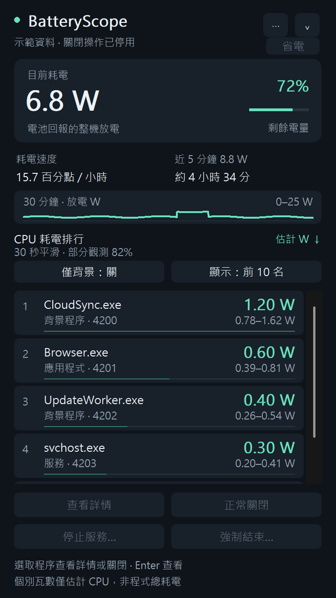
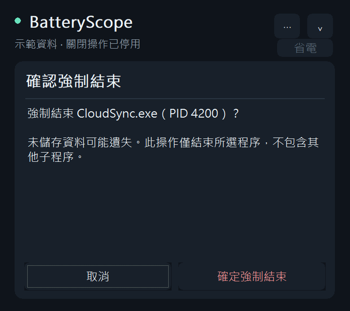

# BatteryScope 0.9.2

以 **C++17 / Win32 API** 實作的 Windows 原生耗電監測工具。深色／淺色直式面板（可跟隨 Windows，支援高對比）、繁體中文／英文介面、單一 EXE，免安裝，資料只在本機處理；選用的每日歷史紀錄也只存在本機。

[English](README.en.md) | 繁體中文



## 開始使用

1. 從 [GitHub Releases](https://github.com/rio10255254/BatteryScope/releases/latest) 下載 `BatteryScope-0.9.2-win64.zip`，解壓後執行 `BatteryScope.exe`。已編譯版本適用 Windows 11 x64。
   升級時先從系統匣結束舊版，再執行新版；程式會避免同時啟動多個正式監測視窗。
2. 目前耗電顯示電池回報的整機放電功率；資料累積後顯示平均功率、耗電速度與預估續航。
3. 硬體能源資料可用時，下方依「估計 CPU W」由高到低列出前 10 個程序／服務。每張卡片第二行顯示類型、PID 與核心分攤模型範圍。點「僅背景」切換背景篩選，點「顯示」切換前 10 名／全部；滑鼠滾輪或鍵盤上下鍵瀏覽。若能源資料不可用，會明確退回 CPU / I/O 活動排行。
4. 選取程序後，可查看詳情、正常關閉、強制結束，或選擇其所屬服務並停止。
5. 點工作列通知區／系統匣的電池小圖示，面板會在圖示附近彈出；再次點擊即收回。也可按 Esc 或右上角收回按鈕。面板不另外佔用工作列應用程式按鈕；收回後繼續低頻採樣。Windows 若把圖示放在隱藏區，可從工作列的向上箭頭找到。
6. 右上角「⋯」或圖示右鍵選單提供「電源模式」、「電池與充電詳情」、「本次累計耗能」、「找出耗電的背景程式」、「匯出 CSV」、「外觀」（主題與風格）、「語言 / Language」、「低電量提醒」、「快速鍵 Ctrl+Alt+B」、「登入時啟動」與「結束 BatteryScope」。登入啟動預設不會主動設定；勾選後寫入目前使用者的 Run 登錄項，登入時啟動至系統匣。若移動了資料夾，下次從新位置手動開啟時會自動把登入啟動改指向新位置；登錄項若指向另一個仍存在的 BatteryScope，則不會變更，需在選單重新勾選。

面板右上角的電源模式按鈕顯示 **Windows 目前實際生效的電源模式**（例如「平衡」「效率」「效能」，節能工具開啟時為「節能中」），資料來自 Windows 公開的 `PowerRegisterForEffectivePowerModeNotifications`。點擊或從「⋯ → 電源模式」開啟電源模式頁：Windows 的「插電時」與「用電池時」是兩個獨立設定，頁面同時列出兩者並標示目前的選擇，各可直接切換為「效率／平衡／效能」。插電時只有「插電時」的設定生效，所以「用電池時」設為效率並不會在插電時降低效能。BatteryScope 第一次變更某一項時，會把原本的設定記在目前使用者的 BatteryScope 登錄項，「還原原本設定」可恢復；不會結束任何程式或服務。系統不提供某項設定時，該排選項會停用。

電源模式頁的「Windows 節能設定」可直接開啟 Windows 自己的節能設定頁，由使用者決定是否啟用「節能工具」及自動啟用門檻；電源模式頁與電池詳情都會顯示 Windows 回報的節能狀態。BatteryScope 不使用未公開介面代替使用者切換節能工具。

「⋯ → 找出耗電的背景程式」只提供**人工檢查清單**：須有可靠的 CPU 能源資料、至少 75% 的 CPU 時間覆蓋，且該程序屬目前使用者、非服務、沒有可見視窗、未連到可見應用程式或服務宿主，並持續活動至少 60 秒、估計 CPU 功率至少 0.5 W。依估計 CPU W 排列最多 5 個。這不能看出同步／下載是否重要、音訊是否正在播放、檔案是否未儲存，亦不代表關閉後必定省下顯示的瓦數；不會自動休眠、停止或終止候選。

面板預設寬 360、高 640 個邏輯像素，比 0.3 版面積減少約 33%，隨 Windows DPI 縮放，並限制在螢幕工作區內。較矮的螢幕會隱藏趨勢圖以保留排行操作空間。程序詳情、充電資訊、節能候選、強制結束確認及操作失敗提示都在同一深色面板內顯示；短確認頁縮至 320 邏輯像素高，返回排行後恢復原高度。服務選擇及必要的 Windows UAC 仍使用系統對話框。



展開時約 220 ms 淡入並短距離滑出，收回約 150 ms；快速再次點擊會從當前進度反向，不排隊播放。按鈕提供約 120 ms 的懸停過渡及按壓回饋，程序耗電條以約 260 ms 過渡到新比例。卡片懸停與選取底色平滑過渡，按壓回彈約 130 ms。瓦數與範圍直接顯示最新估計值，動畫只影響視覺呈現。動畫結束就停止計時器，收回後仍採低頻監測；遵循 Windows 的動畫效果偏好。不提高全系統計時器解析度，實際流暢度依 Windows 排程與顯示環境而異。

清單滾輪採約 180 ms 的逐像素平滑捲動，接受不足一格的滾輪增量並遵循 Windows 捲動行數設定。連續同向輸入累加目的地並保留受限的前進速度，以 Hermite 曲線銜接；反向時直接從目前位置轉向，避免越界回彈；拖曳捲軸則立即跟手。上下鍵、Home／End、Page Up／Down 可選取與移動，Enter 查看詳情。資訊頁的「返回排行」與 Esc 可回到原選取項；確認頁預設焦點在「取消」。捲動、拖曳、按住控制項或面板內資訊頁期間暫緩清單刷新，結束後套用最新排行，盡可能保留頂端程序與列內偏移；切換篩選會回到頂端。收回面板會取消尚未完成的捲動。

### 語言與操作提示

「⋯ → 語言 / Language」可即時切換 **繁體中文 / English**，保留選取身分與捲動位置。設定寫入目前使用者的 `HKCU\Software\BatteryScope\Language`，下次啟動沿用；示範及截圖模式不寫入設定。Windows 的 UAC、原生對話框標準按鈕與系統服務名稱沿用系統語言。

按鈕懸停顯示簡短說明；底部依選取目標提示無視窗、受保護、服務宿主或建議正常關閉。選單與收回按鈕有可供輔助閱讀的文字名稱。沒有可停止服務時停用停止按鈕；選擇服務時預設選取可停止項目。

### 外觀、累計耗能與提醒

- **風格**：「⋯ → 外觀」可選「像素風格」（預設）或「平滑風格」。像素風格的卡片與按鈕使用階梯角、像素外框與按壓下沉的陰影，電池改為格狀電量，30 分鐘圖改為像素長條，耗電條改為分段方塊，大數字以點陣數字繪製；標題、標籤與按鈕使用內嵌的點陣字型。程序名稱、服務名稱、詳情頁長文等由系統或程式提供的文字仍用系統字型；任何字串只要有點陣字型沒有的字，就整串改用系統字型，不會出現方框。
- **主題**：「⋯ → 外觀」可選「跟隨 Windows」（預設，依 Windows 應用程式深色／淺色設定即時切換）、「深色」或「淺色」。Windows 高對比主題啟用時一律改用系統色彩，卡片與按鈕加上外框。圓角、圖表與電池圖示使用 GDI+ 平滑繪製；排行列顯示各程式的圖示，無法讀取路徑的受保護程序以字首方塊代替。
- **系統匣提示**：滑鼠停在圖示上會顯示電量、放電瓦數與預估續航；充電時改為充電瓦數與預估充滿時間。
- **系統匣電量數字**：系統匣圖示直接以點陣數字顯示電量百分比（預設開啟，可在「⋯ → 系統匣顯示電量數字」關閉）。底色表示狀態：插電／充電為綠色、20% 以下為橘色、10% 以下為紅色，其餘為深灰，在深色與淺色工作列上都清楚可讀。
- **電池健康度**：「電池與充電詳情」顯示健康度（目前滿充容量 ÷ 原廠設計容量）與充電循環次數；插電但未充電時，首頁左側小卡片也改顯示健康度。電池未回報設計容量或循環次數時顯示「未提供」；多顆電池時不顯示循環次數。
- **剩餘時間區間**：近 5 分鐘與最長 30 分鐘的平均耗電差距超過 15% 時，續航改以區間顯示（例如「約 3.2–4.1 小時」），短暫的高負載或閒置不會讓數字大幅跳動。
- **充電曲線與充電上限**：BatteryScope 會記住這台電腦在每個 5% 電量區間的實際充電速度；學到的區間涵蓋剩餘路程時，「至充滿」會依充電曲線預估接近滿電時的減速。插電但電量長時間（3 分鐘以上）停在 40–96% 不動時，判定可能有充電上限（電池保護），首頁顯示「充電上限 80%」，充電時改預估到上限的時間。曲線與上限存在 `HKCU\Software\BatteryScope`。
- **GPU 使用率**：面板開啟時，排行列顯示每個程式的 GPU 使用率（≥1% 才顯示，例如「CPU 4.1% · GPU 18%」），詳情頁與 CSV 也有。資料來自工作管理員使用的 Windows「GPU Engine」效能計數器，取最忙碌的 GPU 引擎；這是使用率，不是瓦數。
- **背景耗電提醒**：可在「⋯ → 背景耗電提醒」開啟（預設關閉）。用電池時，若「找出耗電的背景程式」名單中的程式持續 10 分鐘以上、平均約 2 W 以上，會發出一次通知；每個程式只提醒一次，通知間隔至少 10 分鐘，點通知可直接查看名單。
- **歷史紀錄（7 天）**：「⋯ → 歷史紀錄（7 天）」以長條圖顯示每日放電量，並列出每日用電池時間、放電／充電量與 CPU 最耗電的程式。紀錄只存在這台電腦的 `%LOCALAPPDATA%\BatteryScope\history.csv`，保留 60 天，每 10 分鐘與結束時寫入；BatteryScope 沒有執行的時間不會被記錄。可在「⋯ → 歷史紀錄設定」停止記錄或清除；示範與截圖模式不讀寫此檔。
- **本次累計耗能**：自 BatteryScope 啟動以來，依 CPU 能源分攤累計各程式的耗能（mWh），同名程式的多個程序合併計算，已結束的程序也保留，並顯示占 CPU 核心總耗能的比例。需有可用的 CPU 能源計數器。
- **低電量提醒**：可選 10%、20%、30% 或關閉（預設關閉）。電池供電且電量降到門檻時，發出一次 Windows 通知，內容包含目前耗電、預估續航與耗電最高的程序；接上電源或回升 5 個百分點後才會再次提醒。點通知可開啟面板。
- **匯出 CSV**：將目前程序排行（含瓦數、範圍、累計 mWh、記憶體、路徑）與 30 分鐘電量紀錄（`-power.csv`）存成 UTF-8 CSV。程序名稱開頭若像試算表公式，會加上單引號避免被執行。
- **快速鍵**：啟用後可在任何地方按 Ctrl+Alt+B 開關面板（預設關閉）；若已被其他程式使用，會提示且不啟用。

風格、主題、提醒門檻與快速鍵設定都寫入 `HKCU\Software\BatteryScope`；示範及截圖模式不寫入。

### 充電資訊

- 充電時主卡片顯示 **電池端充電 W**，同一區域顯示充電速度（百分點／小時）、至充滿的估計時間及充電 W 曲線。
- 功率取自電池回報的淨充入速率，不是插座耗電、充電器額定功率，也不是 USB PD 協商功率。相對容量或未回報充電速率的電池可能沒有 W。
- 平均取最近最多 2 分鐘的連續有效資料。需至少 60 秒、正向充電且功率相對穩定才顯示至充滿時間；拔電、停止充電、睡眠、缺值與容量異常跳動會重新累積。突然降速時暫停 ETA。
- 時間按剩餘 Wh / 較低的即時與平均充電 W 計算；接近滿電時會減速，韌體的充電保護上限也未知，因此只表示「依目前速度」，不是保證時間。滿電或接電但沒有充電時不編造倒數。
- 「⋯ → 電池與充電詳情」提供容量、平均充電 W 與限制說明。通用 Windows 電源資訊只能確認外部電源，**此版無法可靠區分圓孔或 USB-C**，接頭類型顯示未提供。USB-C 控制器的存在不能證明目前由它供電。

不需要安裝額外的 C++ 執行階段或網頁引擎。沒有網路請求、遙測、常駐系統服務、驅動程式或資料庫。

## 量測與限制

- **整機 W**：使用 `IOCTL_BATTERY_QUERY_STATUS` 讀取電池回報值。硬體實際更新速率與準確度依機型而異。
- **缺少瓦數**：累積至少 2 分鐘、最多近 5 分鐘的絕對容量變化後，嘗試估算平均放電 W，介面會標示估算。只有相對容量／百分比時不換算瓦數。
- **平均與續航**：以近 5 分鐘有效樣本的時間加權平均估算。未滿 5 分鐘時使用已有資料；平均至少累積 10 秒，依功率推估續航至少累積 30 秒。續航是當前負載維持不變的估計。
- **耗電速度**：有絕對容量時以平均 W / 滿充 Wh 換算百分點／小時；否則以至少 2 分鐘的電量百分比變化估計。
- **插電時**：不把電池充電速率顯示成整機耗電。睡眠、電源切換與缺值在曲線上保留空白。
- **程序 CPU 瓦數**：讀取 EMI 核心累積能源，以能量差／時間差取得核心功率。一次系統程序快照取得包含受保護程序在內的 CPU 時間；能確認連續採樣都限制在單一核心的執行緒，優先依該核心能源分攤，其餘依 CPU 時間分配剩餘能源池。資料列以近 30 秒指數平滑 CPU 估計 W 排序。這是有硬體總量約束的 CPU 能源分攤，不是每個程序的獨立硬體量測，也不是保證關閉後能省下的瓦數。
- **模型範圍**：依各核心的能量／忙碌時間，在未知實際程序核心排程位置的情況下，計算最低／最高分攤值。它不是統計信賴區間，也沒有涵蓋指令種類、SMT、驅動能源模型等所有誤差；詳見 [演算法說明](ALGORITHM.md)。
- **完整記帳**：PID 4 的 System 以「Windows 核心」列出但不能操作；DPC、Interrupt、快照間已結束程序及其他沒有程序時間的活動留在「CPU 未歸因」。CPU 以外的電量留在「CPU 以外／未歸因」。CPU 封裝能量已包含核心，不會與核心能量重複相加。
- **估計範圍只涵蓋 CPU**；GPU、螢幕、儲存、網路、核心代辦工作等尚未完整歸因。介面不會把它們依 CPU 使用率硬分配給程序。記憶體僅供參考，不參與能源分攤。
- **詳情**：可查看當次 CPU W、30 秒平滑 W、估計累積 CPU mWh，以及 CPU 部分對應的電池百分點／小時。累計值只涵蓋有有效讀值的觀測區間。
- **硬體相容性**：目前核心分攤驗證於這台 Ryzen 9 8945HS（單一處理器群組、單一封裝、8 核心／16 邏輯處理器），使用 `RAPL_Package0_CoreN_CORE` EMI 通道與 Windows 核心拓樸排序。其他通道命名、多封裝、多群組、缺少 EMI 或缺少 CPU 時間資訊時不編造瓦數，退回活動排行。
- **備援活動排行**：依 30 秒平滑 CPU／I/O 活動排序。CPU 百分比以全機邏輯處理器總量為分母。I/O 包含檔案、網路與裝置，不能等同實體磁碟吞吐量。
- 背景程序係依是否有可見的頂層視窗粗略分類，瀏覽器子程序也會列為背景程序。
- 單一服務宿主會直接顯示服務名稱；共用同一 PID 的多個服務顯示群組與數量，只估計宿主的 CPU 功率，沒有虛構各服務的獨立瓦數。
- **監測範圍**：所有在程序快照當下存活、具有 PID 的程序都會進入採集，包括其他使用者及受保護程序；操作權限不足不等於從能源記帳中排除。執行中 Win32 服務依 PID 掛到宿主；驅動程式與核心工作可能沒有獨立程序，歸於 System 或未歸因。兩次快照間啟動又結束的短暫程序無法逐一列出，耗用的能源仍留在未歸因部分。系統快照不可用時改用 Toolhelp，無法開啟的程序也保留在清單，並標示統計受限。
- 一般權限仍能透過系統快照取得程序 CPU 統計；無法取得路徑、擁有者或安全狀態者列入「操作資訊受限」，不提供關閉。這不代表它們沒有耗電，也不需要為了能源記帳提升權限。
- 關閉會在曲線上留下時間標記；功率變化仍可能來自其他工作，不能認定全部差異都是所關閉程序造成。

## 關閉行為

- 一般權限監測。正常關閉發送 `WM_CLOSE`，應用程式仍可顯示儲存提示或拒絕關閉。
- 強制結束前在面板內顯示確認頁；可按「取消」或 Esc 返回。確認後只結束選取的程序，不遞迴結束子程序。
- 操作前重新核對 PID 與程序建立時間；拒絕已結束／PID 已被重用的目標。
- 只允許關閉同使用者、同工作階段、確認非關鍵且非服務的程序；保護 Windows 桌面、服務宿主與工具本身。
- 服務透過 Service Control Manager 發送停止要求；共用服務程序不提供強制結束。
- 有執行中的相依服務時拒絕停止，不連帶停止相依服務。部分核心系統、安全性與網路服務列入保護名單。
- 只有使用者選擇停止服務且權限不足時，才啟動短暫的管理員輔助程序並由 Windows 顯示 UAC。輔助程序同樣重新檢查目標與相依服務。
- 服務停止逾時會明確回報；系統可能仍在停止中，清單會繼續更新。程式不會更改服務的啟動類型或復原設定，服務有可能被其他元件重新啟動。
- 沒有自動終止規則；只有明確按下「省電」時才調整電池供電的 Windows 電源模式。

## 採樣與資源控制

- 主視窗開啟：程序與 EMI 核心能源每 2 秒，電池每 6 秒，服務清單每 10 秒更新；電池更新與程序採樣對齊，減少額外喚醒。
- 系統匣：先每 10 秒採樣；有效 CPU／核心功率資料持續穩定一分鐘後改為 20 秒。負載升高、功率跳動、缺值或睡眠中斷會恢復 10 秒。展開即採樣並恢復 2 秒；收起時短暫尖峰可能被平均，最久要到下一輪才偵測到變化。
- 收起時只對工具自己的採集執行緒要求 Windows EcoQoS，展開後交還 Windows 自動管理；不調整其他程序，API 不支援時照常監測。
- CPU、I/O 與記憶體由單次系統程序快照同步取得。路徑依 PID＋建立時間快取，失敗後 30 秒重試；操作資格提示最多快取 30 秒，真正關閉時仍重新驗證。退出程序的快取會清除。
- 清單沿用既有原生項目，只增刪數量差異、更新改變的輔助閱讀文字；保留選取身分與捲動位置。收起時停止清單重繪，沒有活躍候選程序就省略執行緒快照。
- 排行顯示「觀測完整／部分觀測／觀測有限」與 CPU 時間覆蓋率。它描述進入記帳的程序時間比例，**不是估計準確率**。程序與能源採樣區間或端點超出容許差異時，本次直接不分攤；詳情顯示端點差與固定核心覆蓋。
- 資料採集在背景執行緒運行；GUI 執行緒僅顯示快照。
- 電池裝置的連線會保留重複使用，只在讀取失敗、每 5 分鐘或尚未找到電池時每分鐘重新列舉；面板收起時服務清單改為每 30 秒更新一次（操作前仍即時重新查核）。
- 記憶體中只保留 30 分鐘電池資料，退出後清除。
- 不要求提高系統計時器解析度，不啟用長時間 ETW 追蹤。
- 固定核心線索只對目前 CPU 較高的至多 12 個程序取樣，每輪最多讀取 2,048 個執行緒；無法讀取者留在未知排程分攤。

## 編譯

本機已使用 MinGW-w64 GCC 15.2 驗證：

```powershell
.\build.ps1 -Test
```

舊版仍在執行時，可使用 `./build.ps1 -Test -OutputDirectory dist/v0.9.2` 編譯到獨立目錄，避免覆寫使用中的 EXE。

預設尋找 PATH 上的 `g++.exe`，其次使用 `C:\mingw64\bin\g++.exe`，並使用同目錄的 `windres.exe`。產出 `dist\BatteryScope.exe`。

另附 CMake 設定供使用現代 Windows SDK 的 MSVC / MinGW 環境使用；本次實機驗證採 `build.ps1`。

```powershell
cmake -S . -B build
cmake --build build --config Release
ctest --test-dir build -C Release --output-on-failure
```

版本號只在 `src/version.h` 維護；`app.rc` 與視窗標題由它產生，CMake 會檢查 `app.manifest` 版本是否一致。測試會從原始碼目錄讀取 `src/`，確認每個介面字串都有英文翻譯。

## 測試及診斷

`tests/tests.cpp` 驗證耗電換算、插電／拔電、睡眠缺口、缺值、相對容量、電量校正、歷史上限、CPU 換算、程序識別與保護規則。關閉整合測試只對測試自行建立的子程序操作；不停止使用者原有程序或真實服務。

```powershell
.\dist\BatteryScope.exe --diagnose C:\temp\diagnostic.txt
.\dist\BatteryScope.exe --screenshot C:\temp\live.bmp
.\dist\BatteryScope.exe --demo
.\dist\BatteryScope.exe --demo-screenshot C:\temp\demo.bmp
.\dist\BatteryScope.exe --demo-screenshot C:\temp\compact.bmp --compact
.\dist\BatteryScope.exe --demo-screenshot C:\temp\light.bmp --light --ledger
.\dist\BatteryScope.exe --ui-test C:\temp\panel-test.txt
.\dist\BatteryScope.exe --tray-test C:\temp\tray-test.txt
```

診斷檔與截圖的上層資料夾須已存在。截圖可加 `--pixel`、`--smooth`、`--light`、`--dark`、`--high-contrast`（以目前系統色彩預覽高對比）、`--ledger`（累計耗能頁）、`--power-mode`（電源模式頁）與 `--history`（歷史紀錄頁）。

### 點陣字型

`src/assets/pixel-ui.ttf` 是 [俐方體11號（Cubic 11）](https://github.com/ACh-K/Cubic-11) 1.451 的子集，只保留介面字串實際用到的約 490 個字（約 110 KB），改名為「BatteryScope Pixel」並內嵌於 EXE，僅供本程式私用、不會安裝到系統。字型依 SIL Open Font License 1.1 授權，授權全文見 `src/assets/pixel-ui-OFL.txt`。

新增或修改介面字串後，請重新產生子集（需要 Python 與 `pip install fonttools`）；面板測試會檢查每個中英文介面字串都能以點陣字型顯示：

```powershell
python tools/subset-pixel-font.py path\to\Cubic_11.ttf
```診斷輸出只包含電池讀值與程序統計數量。示範模式明確標示模擬資料，並停用所有關閉／登入啟動操作。截圖模式建立隱藏視窗，不加入系統匣，保存 BMP 後退出，不會操作其他程序。`--ui-test` 以自己的示範面板驗證通知回呼、顯示狀態、篩選及版面；`--tray-test` 另短暫註冊真實系統匣圖示並驗證圖示位置。兩者均不終止使用者程序，也不更動登入啟動設定。

## 原始碼

- `src/model.*`：純資料模型、耗電統計、活動平滑、低電量提醒門檻與 CSV 欄位跳脫。
- `src/energy_model.cpp`：硬體能源約束分攤、模型範圍、累積能量、瓦數排序與本次累計耗能帳。
- `src/energy_reader.cpp`：EMI V1/V2 裝置、能源差分與 Windows CPU 拓樸／執行時間。
- `src/platform.*`：Windows 電池、程序與服務 API，操作前安全核對。
- `src/motion.h`：有限時間的平滑動畫與連續同向速度銜接。
- `src/i18n.h`：繁體中文／英文介面字串。
- `src/ui.*`：深色／淺色／高對比色盤、GDI+ 平滑繪圖、像素風格繪圖（階梯形狀、格狀電量、點陣數字）、內嵌點陣字型載入與程式圖示快取。
- `src/assets/pixel-ui.ttf`、`tools/subset-pixel-font.py`：點陣字型子集與產生腳本。
- `src/version.h`：版本號唯一來源。
- `src/app.cpp`：原生 GUI、系統匣、採樣排程、權限輔助及診斷模式。
- `tests/tests.cpp`：統計與受控程序生命週期測試。

Windows API 參考：[電池狀態](https://learn.microsoft.com/en-us/windows/win32/power/battery-status-str)、[服務停止](https://learn.microsoft.com/en-us/windows/win32/services/stopping-a-service)、[能源估算資料](https://learn.microsoft.com/en-us/windows/apps/trace-processing/tutorial)。

新版估算方法與不能保證的部分詳見 [ALGORITHM.md](ALGORITHM.md)，實機證據及測試範圍見 [VALIDATION.md](VALIDATION.md)。
